# Deadlock Hero Swap — A Simple Guide For Quick N Dirty Deadlock Mods

Want Deadlock's heroes wearing someone else entirely? This guide walks you through the
whole thing from Blender: drop a character and her outfit onto a hero rig, keep the
character's actual proportions instead of a squashed and stretched character, get the secondary motion
still moving the way it should, and compile a working local mod — all from the
**Hero Swap** sidebar.

The screenshots come from real work in Blender: Miruko → Abrams, Krystal (imported from SFM,
wearing the Nightmare Moon outfit) → Pocket, and ReVamped Trixie → Sinclair. Anything
humanoid should follow the same path. Characters that are a very different shape — Baba and
friends — haven't been tested yet, so expect to do some hand-fitting there.

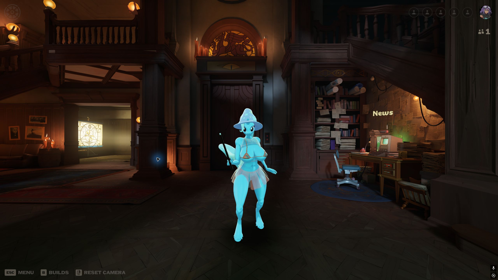

*Not a render — this is an actual in-game capture. 

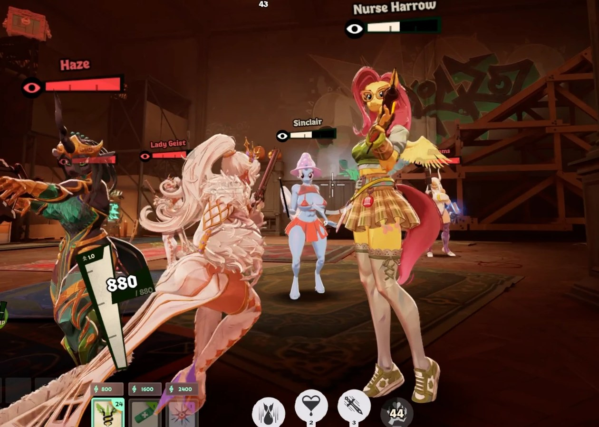

*Several swaps loaded together in one match, each a separate local mod for a different hero.*

## Start here

1. [Get the tools installed](#0-one-time-setup).
2. [Import the hero](#step-1-import-the-hero), then [get your character ready](#step-2-get-your-character-ready).
3. [Fit the outfit](#step-3-outfit-optional) — and if you want see-through fabric, [test the transparency](#optional-making-clothes-see-through).
4. [Sanity-check the bone map](#step-4-check-the-bone-map), then [keep her proportions and fix the tail](#step-5-fit-proportions-and-jiggle-bones).
5. [Export, install, and go look at her in-game](#step-6-export-build-and-install).

## 0. One-time setup

Both documented builds were made with **Blender 5.2** on Windows.

| Tool | What it's for |
|---|---|
| [Blender Source Tools](https://github.com/Artfunkel/BlenderSourceTools) | Import/export source DMX and SMD assets |
| [SourceIO](https://github.com/REDxEYE/SourceIO) | Import compiled SFM/Source `.mdl` assets and materials |
| [Hero Swap add-on](addon/hero_swap_tools) | The sidebar workflow this guide walks you through |
| [Source 2 Viewer CLI](https://github.com/ValveResourceFormat/ValveResourceFormat/releases) | Pull the target hero out of your installed game |
| Reduced CSDK 12 | Compile materials with Deadlock shaders |
| CS2 Workshop Tools | Compile the model with AnimGraph 2 |

Install and enable the Blender add-ons under **Edit → Preferences → Add-ons**. Then copy
this repository's `addon/hero_swap_tools` folder into
`%APPDATA%\Blender Foundation\Blender\5.2\scripts\addons` and restart Blender. CS2
Workshop Tools come through Counter-Strike 2's Steam DLC settings.

One heads-up on the Source Tools version used here: Blender 5 needed a small guard in
`io_scene_valvesource/flex.py`, inside `addDrivers`. If your version removes a modifier
without first checking that one exists, swap that line for:

```python
if len(fcurve.modifiers):
    fcurve.modifiers.remove(fcurve.modifiers[0])
```

### Tool paths, spelled out

Open the 3D Viewport, press **N**, open **Hero Swap**, and click **Tool Paths...** (the same
fields live under **Edit → Preferences → Add-ons → Hero Swap Tools**). These are add-on
preferences — completely separate from the rig pickers in the scene — so if automatic
preference saving is off, click **Save Preferences** when you're done.

| Field | Select | What should be in there |
|---|---|---|
| Deadlock | Steam's Deadlock installation root | `game/citadel/pak01_dir.vpk` |
| Reduced CSDK | Extracted Reduced CSDK 12 root | `game/bin/win64/resourcecompiler.exe` |
| CS2 | Steam's `Counter-Strike Global Offensive` root | CS2 with Workshop Tools installed |
| Source 2 Viewer CLI | `Source2Viewer-CLI.exe` | the CLI executable, *not* the graphical viewer |
| Work Folder | A writable directory of yours | extractions, references and build staging — keep it out of the game archives |

Steam users can find a game on another drive via **Manage → Browse local files**. Do not
point the Deadlock field at its `citadel` or `addons` subfolder.

The **1 2 3 4 5 6 All** row along the top just jumps between workflow sections — it isn't a
progress bar.

## Step 1: Import the hero

Pick your target hero and click **Import Hero Skeleton**. The add-on reads the hero list
straight from your installed game, extracts that model, and brings in the skeleton — no
separate skeleton pack to download — with the original mesh left hidden as a reference
so you have something to line up against.

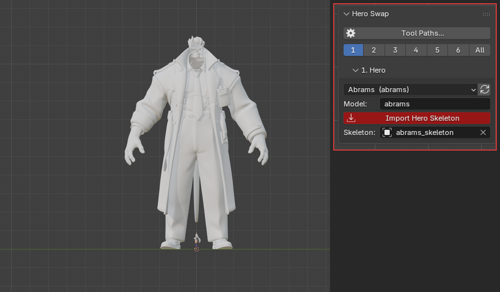

The hero list shows every hero as **Display name (internal name)**:

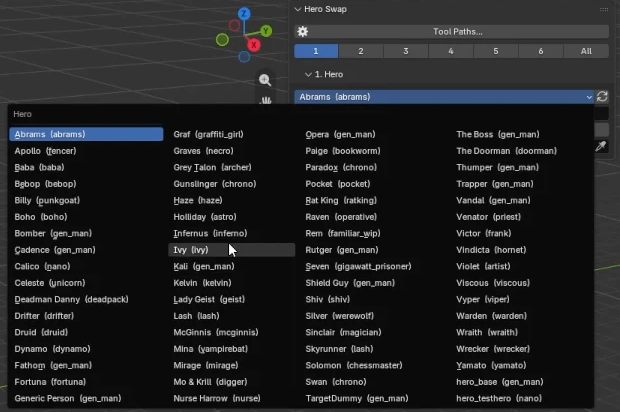

Watch out for display names vs. internal names, because they don't always match:
Sinclair is `magician`, for instance. Leave the weapons and ability props alone unless
you're deliberately swapping those too.

## Step 2: Get your character ready

Open the character's `.blend`, or import her source assets first — SourceIO for compiled
`.mdl` files, Source Tools for DMX/SMD. Either way, **File → Save As** a working copy
before you touch anything, then check your texture paths and pack or relink anything
missing. Grey meshes are the clue that textures didn't come along.

Characters from other games come in as FBX. [Game Model To FBX](https://github.com/ClubVixen/Game-Model-To-FBX)
converts Marvel Rivals, Zenless Zone Zero and Koikatsu models. For Koikatsu, export the
character from the game first with the KKBP exporter (**Export Model for KKBP** in the
character maker), then convert that export:

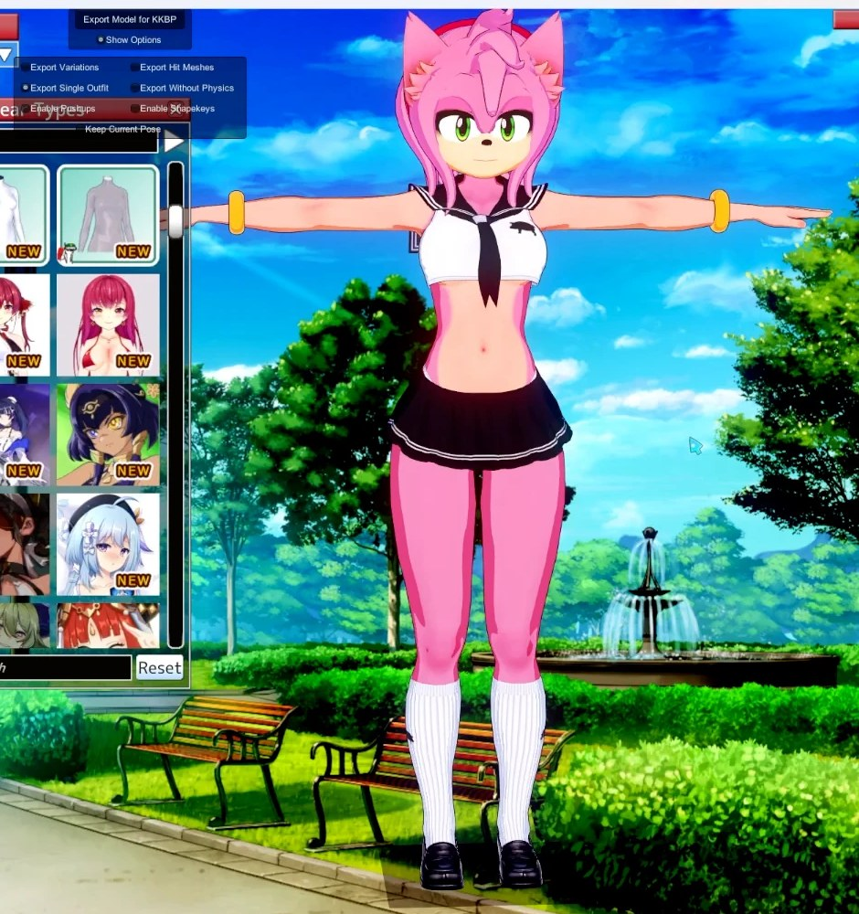

In **2 / Character**, point **Rig** at the *replacement* character's armature — not the
hero armature you just imported, and not a mesh. Decide up front which body shape, outfit
variants and feet you're actually going to use — this matters for models like the ReVamped
Ponies — and exclude the rejects from rendering and export, not just the viewport.


| Control | Reach for it when |
|---|---|
| **Clean Up Character Meshes** | You need modifiers, bone-parented parts and vertex groups tidied for the swap |
| **Load Source Textures** | Imported Source assets came in grey — point Materials at their material folder |
| **Convert Source Eyes to Textures** | Bake SourceIO/EyeRefract eyes before fitting; exclude separate eyelens meshes |
| **Delete Faces with These Materials** | You want geometry gone by material — on a saved copy, please |

Keep the body shape values you actually want. Fitting the clothing to the body is the
job; warping the body to rescue a badly fitted garment is not.

The same panel on an SFM import, with every field filled:


And on a Marvel Rivals character converted to FBX — the Source-only texture and eye
fields stay empty, because the FBX brought its own materials:

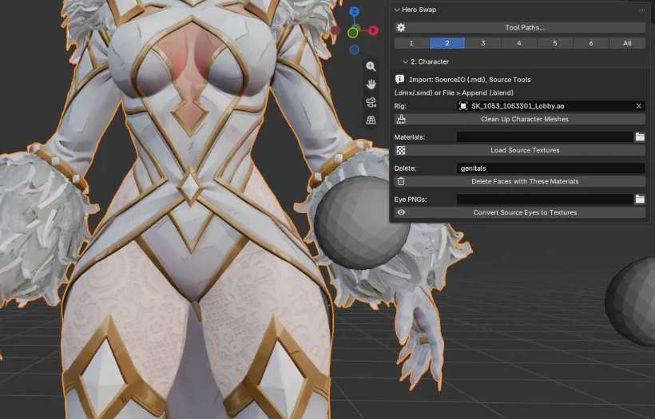

## Step 3: Outfit (optional)

### When the outfit was made for the same skeleton

In **3 / Outfit**, set **New Body** to the skin mesh. **Rig** wants an armature;
**New Body** wants the mesh whose shape and surface the clothing should follow.

1. Select only the garment meshes.
2. Click **Match Outfit to Body Shape Keys**. Leave **Create Missing** off to start with
   if the garments already have matching controls.
3. Click **Bone-merge Selected onto Character**, with **Merge onto Outfit Rig instead** off.
4. Walk around her — front, side, top. Look closely at the chest, waist, crotch, gloves
   and foot openings.
5. Back in the rest pose, dial in **Reach** and **Gap**, then click **Conform Clothing to Current Shape**.


This route is mostly for the ReVamped Ponies, or any model that shares a body. It also
works on Fo4 mods, since Fo4 reuses one body across multiple models — ponies included,
in the CaN mod. Krystal was a poor example, but I can't be asked to show a better example.

**Conform Clothing to Current Shape** works from the evaluated surfaces: it pushes
intersecting clothing outward and carries the correction across all its shape keys, without
reshaping the body underneath. Apply topology-changing modifiers first, and set Reach and
Gap to your scene scale — the example here ran `0.08` and `0.003` (a narrow panel may round
the displayed Gap down to `0.00`).

It won't land you at 100%, but 80–90% is normal. Check the gaps yourself and finish the
rest by hand.

### When the outfit was made for a different body

1. Import the body the outfit was originally built for.
2. If it needs it, select that reference body, switch on **Merge onto Outfit Rig instead**,
   and bone-merge it onto the outfit rig.
3. Point **Outfit Rig**, **Its Body**, and **New Body** at the outfit armature, its original
   reference body, and your character's skin mesh — in that order.
4. Click **Fit Outfit to Character**, then walk around the result and look it over. The outfit
   is posed onto your character's skeleton, the original body is morphed onto the new one, and
   the outfit travels with it.
5. If the garment covers skin completely, **Delete Skin Under Outfit** removes that covered skin
   and pushes anything still poking through back under the cloth. Openings, translucent areas,
   the neck and head are left alone.

**Skin Swaps** rename materials by `old=new` pairs — the usual way a flat-colour piece gets its
textured version instead.


The full panel, including the skin swaps, shape-key matching and the independent
body/outfit adjustments:

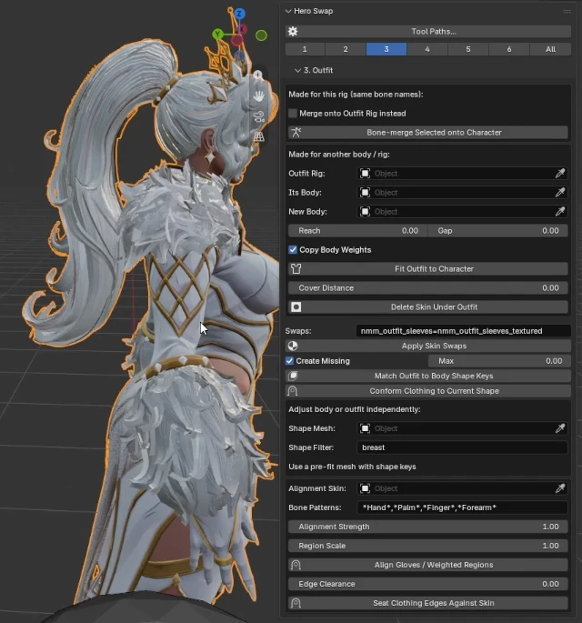


## Optional: making clothes see-through

1. Select the outfit and open **Material Properties** via the material sphere icon.
2. Duplicate the material if an opaque underlayer is sharing it — otherwise you'll make
   *that* transparent too.
3. In the Principled BSDF **Surface**, drop the unlinked **Alpha** slider to `0.45`. That
   value reads really well on fabric.
4. In the material's **Settings / Surface**, pick **Render Method: Blended**.
5. Switch to Material Preview or Rendered view, then repeat for every slot you want see-through.


Remember: `1.0` is solid, `0.0` is gone. In the Trixie build the bra stays opaque and
only the outer top and skirt go to 45%.

The exporter handles the game side for you — it writes a separate opacity texture into
`TextureTranslucency1` and sets `F_TRANSLUCENT`.

## Step 4: Check the bone map

Click **Auto-detect Bone Map**, then actually inspect both sides with **Character bones /
Hero bones** — auto-detect is a head start, not a finished answer. Go over the pelvis,
torso, neck, shoulders, elbows, hands, fingers, thighs, knees and feet. Anything wrong,
fix the row with the bone picker, then click **Save Bone Map**.


Auto-detect has been tried against Blender/Rigify, Valve biped (`bip_`), VA/ReVamped and
Deadlock rigs. IK, pole and control bones are skipped on purpose, which is why a correct
result can still look sparse.

Detection on a Valve-biped import — Deadlock's `pelvis`, `spine0`, `neck` and `hand_L`
against the rig's `bip_` bones, ready to save as a per-hero map such as `pocket.json`:

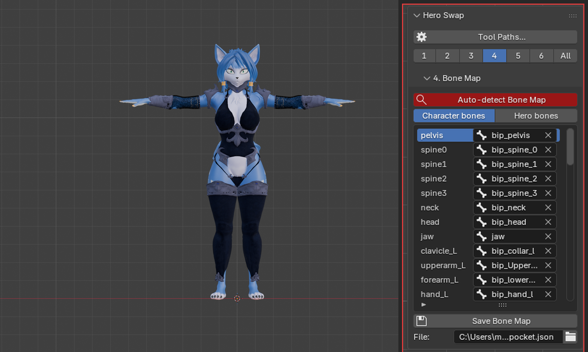

And a Marvel Rivals rig going onto Lady Geist. Hover a row to see its source bone;
**Save Bone Map** writes the file shown under **File**:

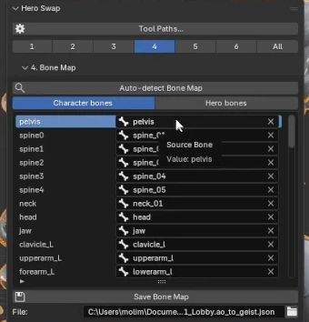


## Step 5: Fit, proportions and jiggle bones

Start from the clean pre-fit scene and a fresh hero skeleton — the fitter refuses a second
fit onto bones that already carry generated `CV_` bones.

1. Switch on **Preserve Source Proportions (Experimental)** and **Keep Jiggle Bones**.
   **Keep Head Proportions** stays on unless you have a reason: a hero who carries his head low
   (Abrams does) would otherwise sink the character's head into her torso. It only ever raises a
   head, never lowers one.
2. Stick with the bundled `jiggle_presets.json` for default physics. The optional
   [ReVamped preset](config/jiggle_revamped_single_springs.json) replaces it on compatible
   rigs, but it's a nice-to-have, not a requirement — see
   [preset selection](docs/jiggle-bones-and-presets.md#which-preset-to-use).
3. Click **Fit Character to Hero** once. Just once, then look.
4. Check the waist, shoulders, hands and feet. Re-run the clothing clearance checks in the
   hero rest pose, with Reach and Gap rescaled for the new character size.
5. Save a separate editable fitted `.blend`.


Two more fitted characters, each standing beside the hero whose rig they took:

| Miruko on Abrams, front and side | Krystal on Pocket, front and side |
|---|---|
|  |  |
|  |  |

In this example the tail's root is `CV_TailBase` — chosen as a solid anchor point rather
than one more physics spring. The export keeps 15 jiggle bones: two breast, two butt,
four hair, seven tail. Check your preset's bone names again for every new character.

### Picking jiggle bones and dialling in motion

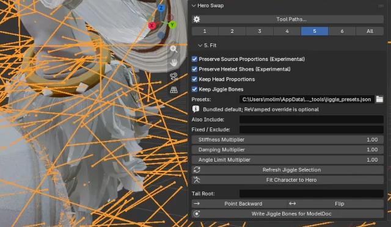

Rigs with a lot of hair and cloth bones (the orange sticks above) need narrowing down. Use
**Also Include** for extra bones the preset misses, such as ribbons. Use **Fixed / Exclude** for
roots and anchor bones, such as hat brims and the first bone of each hair chain. Both fields take
comma-separated patterns (`ribbon_*`, `hair_*_root`). Click **Refresh Jiggle Selection** after
changing either field.

The [illustrated jiggle selection and tuning guide](docs/jiggle-bones-and-presets.md) covers
fixed anchors, cape/hair selection, refreshing after a fit, and stiffness, damping and angle
limits.

### Heels and floating weapons

Rigid heels: switch on **Preserve Heeled Shoes (Experimental)** under
**Preserve Source Proportions** *before* you fit a clean source mesh.
[Heel fitting and recovery steps](docs/proportions-heel-shoes-and-weapon-grip.md#part-2--rigid-heel-shoes)
has the details. If a fitted mesh is already distorted, you can't rescue it here — restore it
from the pre-fit checkpoint.

Floating guns: leave the body proportions alone and fix the visual weapon's attachment
instead. Follow the [Miruko/Abrams weapon correction steps](docs/proportions-heel-shoes-and-weapon-grip.md#part-3--a-weapon-that-follows-the-new-hand).
That one is still a manual DMX/ModelDoc workflow — it isn't automated yet.

### Why this avoids the compressed torso

Here's the trap: the original fit moves the source joints onto the hero's joints, and if
the hero's proportions differ, that silently shortens the torso.
**Preserve Source Proportions** takes the other route — it builds a `CV_` deformation
skeleton using uniformly scaled source lengths, driven by the hero's rotations. The
hero's animation graph survives untouched; it doesn't rewrite animation clips and it
doesn't change gameplay hitboxes.

| Original fit: compressed torso | Corrected source-proportion fit |
|---|---|
|  | 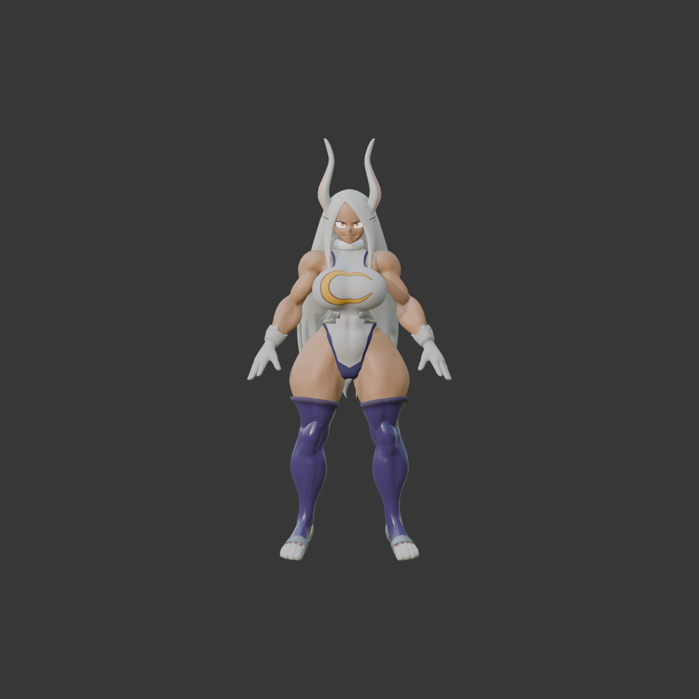 |

Toggling the option on an already-crushed mesh won't un-crush it — reopen the clean
checkpoint. Saving a copy at every stage is what makes that possible.

Full write-up with the running-pose preview, measured segment lengths and constraint
details: [proportions, heel shoes and weapon grip](docs/proportions-heel-shoes-and-weapon-grip.md).

## Step 6: Export, build and install

Save the editable file, then make an export copy from it. If you don't need runtime
flexes, bake the current shape mix into that copy. And no — you don't have to join
everything; clothing can stay as separate mesh objects on the shared skeleton.

In **6 / Export + Build**:

1. Give **Addon** and **Skin Folder** unique names, and tick the **Meshes** collection.
2. Tick **Replace**. Swap the body meshes you mean to swap, and keep the weapons and
   ability props — this Sinclair build replaces `magician_body`.
3. Click **Export Model + Materials**.
4. Pick a **Pak** number that isn't in use — and remember a *lower* number loads first, so it
   wins over other mods replacing the same hero. Running Deadlock Mod Manager? Leave
   **Install** unchecked, then click **Build + Install Mod** to produce the package.
5. In your existing mod-manager profile, use **Add Local Mod** to import the resulting VPK.
   Replace only the older mod that conflicts for this hero, and keep a restore copy.
6. Restart Deadlock and go see what loaded.

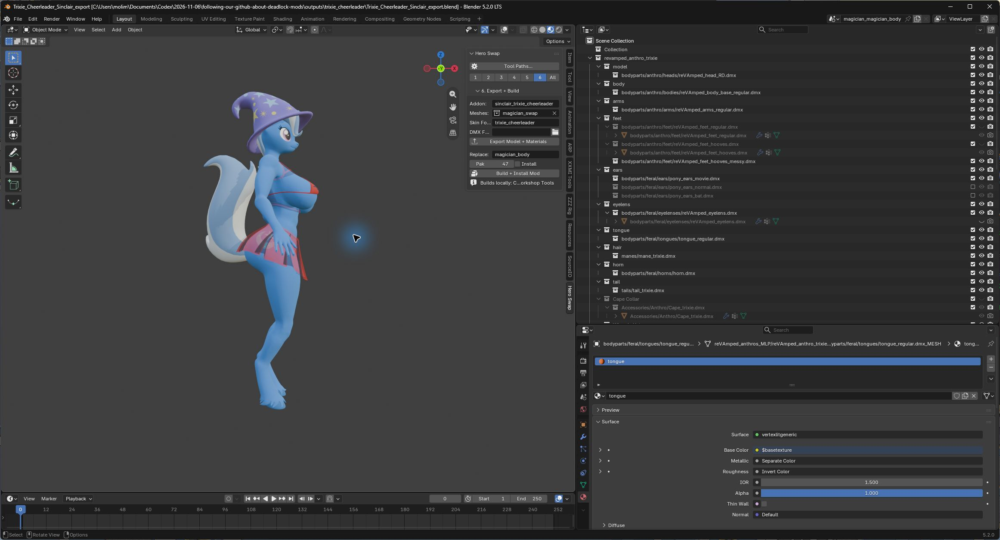


Behind that one button: the build exports textures, materials, DMX, jiggle settings and
`proportion_constraints.kv3`, compiles materials and model with the CSDK and CS2 tools, and
packs a `pakNN_dir.vpk` — your meshes in for the hero's body, weapons kept, and your
proportion drivers merged into the hero's existing constraint list. Your other mods are left
alone; hashes confirmed every other installed VPK was untouched in this test.

## What she looks like in Deadlock

| Miruko on Abrams | Trixie on Sinclair |
|---|---|
| 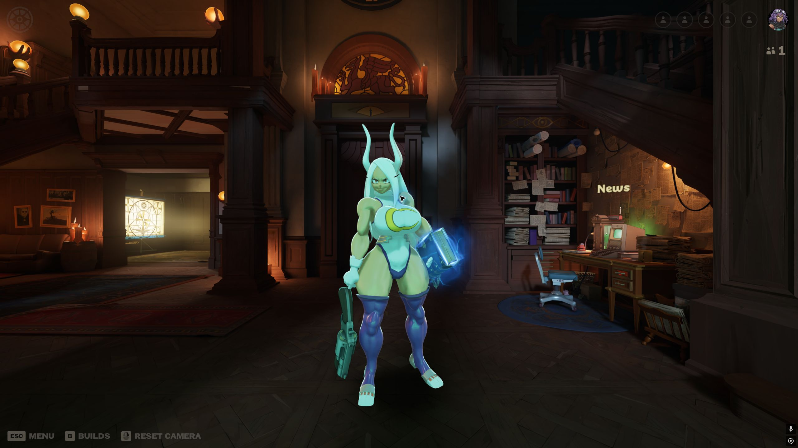 |  |


## When something looks wrong

| Symptom | Where to look |
|---|---|
| Torso is compressed | Reopen the source checkpoint and use **Preserve Source Proportions (Experimental)** |
| Clothing still clips | Confirm **New Body**, match shape keys, check the evaluated surfaces, then repeat clearance after the hero fit |
| Gloves or openings baggy | Measure the real mesh distance — outward clearance pushes clothing out, it never tightens loose clothing |
| Transparent cloth shows holes | Restore the skin under that area from the editable checkpoint |
| Alpha looked right in Blender, opaque in-game | Use the updated exporter and supported Alpha path, then rebuild and restart the game |
| Tail points sideways | Set the full chain's **Tail Root**, hit **Point Backward**, and check from the side and rear |
| Stuck in a rest pose in-game | Confirm the proportion constraints exported and merged into the existing constraint list |
| Stretched triangles | Check the reported unweighted-vertex repairs and your deliberate attachment weights |
| Old model keeps showing up | Another package is probably replacing the same hero — settle that conflict instead of disabling unrelated mods |

## Handing the whole thing to an agent

You don't have to be the one clicking through Blender. [`AGENTS.md`](AGENTS.md) is written
for a model driving the pipeline — a ChatGPT agent on your computer, Codex, Claude, or
tools like Cowork — with the repo map, the exact run order, operator names, what
to check after each step, and what genuinely counts as verified.

The short version to paste at it:

> Read `AGENTS.md` in this repository, then swap `<character>` onto `<hero>` following the
> runbook. Blender 5.2, keep source proportions, and stop for my review before you build a
> VPK.

It still needs a real Blender on your machine and your eyes for the in-game pass — an agent
cannot certify its own screenshots.

## What's in this repo

| Path | What it is |
|---|---|
| `addon/hero_swap_tools/` | The Blender add-on — install this one |
| `config/` | Jiggle presets and an example build config |
| `docs/` | The three deep guides |
| `AGENTS.md` | Runbook written for AI agents |
| `tools/` | `build_mod.py` and `pack_vpk.py`, used by the add-on's build step |

Rebuilding an exported configuration locally:

```powershell
python tools/build_mod.py <path-to-build_config.json>
```

## Going deeper

- [Fitting an outfit and testing transparency](docs/fitting-outfits-and-transparency.md)
- [Jiggle bones, presets and tuning](docs/jiggle-bones-and-presets.md)
- [Proportions, heel shoes and weapon grip](docs/proportions-heel-shoes-and-weapon-grip.md)
- [Example build configuration](config/example_build_config.json)
