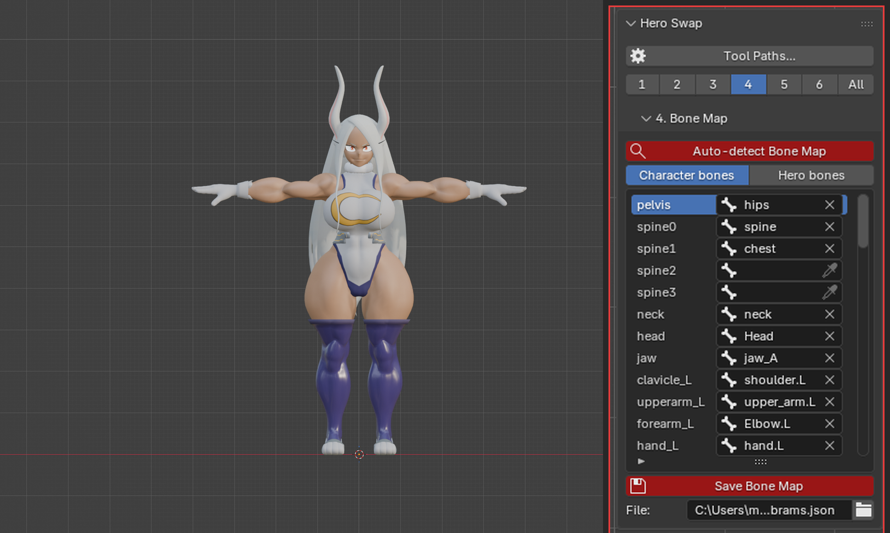

# Deadlock Hero Swap — illustrated Blender tutorial

Fit a character and outfit to a Deadlock hero, preserve the character's proportions,
set up secondary motion, and compile a local mod from Blender's **Hero Swap** sidebar.
This guide follows the corrected Miruko → Abrams and ReVamped Trixie → Sinclair builds.
The same workflow can be adapted to other humanoid models; bone maps, clothing fit,
and animation contacts still need checking for each character.


*Actual Deadlock hideout capture. The outer top and skirt use 45% opacity; the bra remains opaque.*

The screenshots show the real Blender controls and loaded game results. Older import
and bone-map screenshots have a red button highlight and enlarged sidebar; newer
screenshots show the interface directly. Full button names are repeated below.

## Start here

1. [Install the tools](#0-one-time-setup).
2. [Import the hero](#step-1-hero) and [prepare the character](#step-2-character).
3. [Fit the outfit](#step-3-outfit-optional), then optionally [test transparency](#optional-semi-transparent-clothing).
4. [Check the bone map](#step-4-bone-map), then [preserve proportions and correct the tail](#step-5-fit-proportions-and-jiggle-bones).
5. [Export, install and inspect in-game](#step-6-export-build-and-install).

Keep three separate files: an untouched source scene, an editable fitted scene, and
an export copy. Third-party models and compiled VPKs are not included in this repository.

## 0. One-time setup

The documented builds used **Blender 5.2** on Windows.

| Tool | Purpose |
|---|---|
| [Blender Source Tools](https://github.com/Artfunkel/BlenderSourceTools) | Import/export source DMX and SMD assets |
| [SourceIO](https://github.com/REDxEYE/SourceIO) | Import compiled SFM/Source `.mdl` assets and materials |
| [Hero Swap add-on](addon/hero_swap_tools) | The sidebar workflow in this guide |
| [Source 2 Viewer CLI](https://github.com/ValveResourceFormat/ValveResourceFormat/releases) | Extract the target hero from your installed game |
| Reduced CSDK 12 | Compile materials with Deadlock shaders |
| CS2 Workshop Tools | Compile the model with AnimGraph 2 |

Install and enable the Blender add-ons in **Edit → Preferences → Add-ons**. Copy this
repository's `addon/hero_swap_tools` folder into
`%APPDATA%\Blender Foundation\Blender\5.2\scripts\addons`, then restart Blender.
Install CS2 Workshop Tools through Counter-Strike 2's Steam DLC settings.

For the Source Tools version used here, Blender 5 required a guard in
`io_scene_valvesource/flex.py`, inside `addDrivers`. If that version removes a modifier
without checking whether one exists, replace that line with:

```python
if len(fcurve.modifiers):
    fcurve.modifiers.remove(fcurve.modifiers[0])
```

In the 3D Viewport, press **N**, open **Hero Swap**, and click **Tool Paths...**.
Set the Deadlock folder, Reduced CSDK folder, CS2 folder
(`...\Counter-Strike Global Offensive`), `Source2Viewer-CLI.exe`, and a work folder.
The **1 2 3 4 5 6 All** row selects the workflow sections.
See [exact path and skeleton setup](docs/heels-and-setup.md#game-paths-and-skeletons)
for which directory each field expects.

## Step 1: Hero

Choose the target hero and click **Import Hero Skeleton**. The add-on reads the hero
list from your installed game, extracts the selected model, and imports its skeleton
with the original mesh hidden as a reference.


Display and internal names can differ: Sinclair uses `magician`, for example. Check
the replacement mesh list instead of assuming every mesh belongs to the body. Keep
weapons and ability props unless you are deliberately replacing those too.

## Step 2: Character

Open a character `.blend` or import its source assets, then **File → Save As** a working
copy. For compiled `.mdl` assets, use SourceIO; for DMX/SMD, use Source Tools. Check
texture paths and pack or relink missing images before continuing.

In **2 / Character**, set **Rig** to the character's armature. Choose the body shape,
outfit variants and feet you intend to use before fitting. Exclude unwanted alternatives
from rendering/export as well as the viewport.


| Control | When to use it |
|---|---|
| **Clean Up Character Meshes** | Prepare modifiers, bone-parented parts and vertex groups for the swap |
| **Load Source Textures** | Imported Source assets are grey; point Materials to their material folder |
| **Convert Source Eyes to Textures** | Bake SourceIO/EyeRefract eyes before fitting; exclude separate eyelens meshes |
| **Delete Faces with These Materials** | Deliberately remove unwanted geometry by material; work on a saved copy |

Keep the body shape values you want. Clothing should fit those values, rather than
changing the body to compensate for an incorrectly fitted garment.

## Step 3: Outfit (optional)

### Outfit made for the same character skeleton

In **3 / Outfit**, set **New Body** to the skin mesh. **Rig** is an armature;
**New Body** is the mesh whose shape and surface the clothing should follow.

1. Select only the garment meshes.
2. Click **Match Outfit to Body Shape Keys**. Leave **Create Missing** off initially
   when matching controls already exist on the garments.
3. Click **Bone-merge Selected onto Character**, with **Merge onto Outfit Rig instead** off.
4. Inspect front, side and top views. Check the chest, waist, crotch, gloves and foot openings.
5. In the rest pose, set **Reach** and **Gap**, then click **Conform Clothing to Current Shape**.


**Conform Clothing to Current Shape** uses the evaluated body and clothing surfaces.
It moves intersecting clothing outward and applies the correction across its shape
keys without reshaping the body. Apply topology-changing modifiers first. Set Reach
and Gap relative to the model's scene scale; the example initially used `0.08` and
`0.003` in source space. A narrow field may round the displayed Gap to `0.00`.

This operation does not tighten every loose panel or create missing crotch coverage.
Compare the actual clothing-to-body distance, inspect openings and garment layers,
and correct remaining excess space or missing geometry manually. Repeat the check
after changing shape values and after fitting to the hero.

### Outfit made for a different body or skeleton

1. Import the body the outfit was authored for.
2. If needed, select that reference body, enable **Merge onto Outfit Rig instead**,
   and bone-merge it onto the outfit rig.
3. Set **Outfit Rig**, **Its Body**, and **New Body** to the outfit armature, its
   original reference body, and your character's skin mesh respectively.
4. Click **Fit Outfit to Character**, then inspect the result from several angles.

Matching bone names alone does not establish compatible rest positions. Use the
reference-body workflow for different rigs and keep a checkpoint before transferring.
For opaque garments, **Delete Skin Under Outfit** can remove covered skin, but inspect
the result carefully and retain skin beneath openings or translucent material.

## Optional: semi-transparent clothing

1. Select the outer garment and open **Material Properties** using the material sphere icon.
2. Make a separate material copy if the same material is also used by an opaque underlayer.
3. In the Principled BSDF **Surface**, set the unlinked **Alpha** slider to `0.45`.
4. In Blender 5.2 material **Settings / Surface**, choose **Render Method: Blended**.
5. Use Material Preview or Rendered view, and repeat for the appropriate material slots.


`1.0` is opaque; `0.0` is invisible. The example keeps the bra opaque and makes the
outer top/skirt 45% opaque. Keep the skin underneath transparent fabric.

The exporter writes a separate opacity texture into `TextureTranslucency1` and enables
`F_TRANSLUCENT`. An RGBA color texture alone does not supply this shader input.
Arbitrary procedural Alpha networks are not baked by this workflow. Check layered
transparency in-game: Blender preview alone cannot establish the final sorting or look.

## Step 4: Bone map

Click **Auto-detect Bone Map**, then inspect both sides using **Character bones / Hero bones**.
Check pelvis, torso, neck, shoulders, elbows, hands, fingers, thighs, knees and feet.
Fix incorrect rows with the bone picker, then click **Save Bone Map**.



A successful auto-detection is a starting point. In particular, do not squash a torso
to compensate for a poor spine mapping or a hero with different proportions.

## Step 5: Fit, proportions and jiggle bones

Start from the clean pre-fit scene with a fresh hero skeleton.

1. Enable **Preserve Source Proportions (Experimental)** and **Keep Jiggle Bones**.
2. Keep the bundled `jiggle_presets.json` for default physics. The optional
   [ReVamped preset](config/jiggle_revamped_single_springs.json) replaces it for
   compatible rigs; it is not required. See [preset selection](docs/heels-and-setup.md#jiggle-presets).
3. Click **Fit Character to Hero** once.
4. Inspect the waist, shoulders, hands and feet. Repeat clothing clearance checks in
   the hero rest pose using Reach and Gap scaled to the new character size.
5. For a tail, set **Tail Root** to the whole chain's root, then click **Point Backward**.
   Inspect side and rear views. Use **Flip** only if the curl needs reversing.
6. Save a separate editable fitted `.blend`.


For this example the root is `CV_TailBase`, a stable attachment rather than an extra
physics spring. The export retains 15 jiggle bones: two breast, two buttock, four hair
and seven tail. Review the preset's bone names for each new character.

### Choosing jiggle bones and motion strength

Follow the [illustrated jiggle selection and tuning guide](docs/jiggle-bones.md) for
fixed anchors, cape/hair selection, refresh after fitting, and stiffness, damping
and angle limits. It uses the actual sidebar controls and explains which settings
require a custom preset.

### Heels and floating weapons

For rigid heels, enable the new **Preserve Heeled Shoes (Experimental)** option
under **Preserve Source Proportions**, before fitting a clean source mesh.
See [heel fitting and recovery steps](docs/heels-and-setup.md#heels).
An already distorted fitted mesh must be restored from the pre-fit checkpoint.

For floating guns, keep the body proportions and correct the visual weapon's
attachment. Follow the [Miruko/Abrams weapon correction steps](docs/weapon-grip.md).
This advanced DMX/ModelDoc workflow is not yet a sidebar button; idle contact was
verified, but firing/reload contact remains unverified.

### Why this avoids the compressed Miruko torso

The original fit moves source joints onto the hero's joints, which can shorten a
character's torso. **Preserve Source Proportions** instead adds a `CV_` deformation
skeleton with uniformly scaled source lengths, driven by the hero's rotations.
It preserves the hero's animation graph; it does not rewrite animation clips or
change gameplay collision bounds. Hand/weapon and foot contacts still need testing.

| Original fit: compressed torso | Corrected source-proportion fit |
|---|---|
|  |  |

Enabling the option on an already crushed mesh cannot restore the source geometry.
Reopen the clean checkpoint. The older **Preserve Torso Proportions** option is a
different experiment and is not the mode used here.

See the [Miruko correction guide](docs/miruko-abrams-proportions.md) for the running-pose
preview, measured segment lengths and constraint details.

## Step 6: Export, build and install

Save the editable file, then make an export copy. If runtime flexes are unnecessary,
bake the current shape mix in that copy. Clothing can remain separate mesh objects
on the shared skeleton; joining everything is not required.

In **6 / Export + Build**:

1. Set a unique **Addon** and **Skin Folder**, and check the **Meshes** collection.
2. Check **Replace**. Replace the intended body meshes while keeping weapons and
   ability props; this Sinclair example replaces `magician_body`.
3. Click **Export Model + Materials**.
4. Choose an unused **Pak** number. Leave **Install** unchecked when using Deadlock
   Mod Manager, then click **Build + Install Mod** to build the package.
5. In your existing mod-manager profile, use **Add Local Mod** to import the resulting
   VPK. Replace only the conflicting older mod for this hero and keep a restore copy.
6. Restart Deadlock and inspect the loaded character.


The local build exports textures, materials, DMX, jiggle settings and
`proportion_constraints.kv3`; compiles materials and the model; then packs the VPK.
The builder merges proportion drivers into the hero's existing constraint list.
Keep unrelated mods enabled. In this test, hashes confirmed that all other installed
VPKs, including Sunset Shimmer for Celeste, were unchanged.

## Check the result in Deadlock

Inspect front, side and rear views in the hideout first. Check body shape, clothing
coverage, transparent layers, tail direction and weapon attachment. Then test walking,
running, crouching, jumping, melee, firing, abilities and animation transitions.
Watch for clipping, foot sliding, grip offsets and unstable secondary motion.

| Miruko on Abrams | Trixie on Sinclair, corrected tail |
|---|---|
|  |  |

The two builds were inspected in the hideout. Miruko's measured segment lengths were
preserved, and the Trixie build retained the original body sliders while exporting
13 meshes, 20 materials and 15 jiggle bones. The final Trixie rest-pose vertex check
found no garment vertices more than 0.1 mm inside the body in source scale.

These checks do not certify every triangle or animated frame. Full combat-animation
and individual physics-region testing remain pending. The Trixie compile completed
with a single-LOD warning and no compile failures.

## Troubleshooting

| Symptom | Check |
|---|---|
| Torso is compressed | Reopen the source checkpoint and use **Preserve Source Proportions (Experimental)** |
| Clothing still clips | Confirm **New Body**, match shape keys, check the evaluated surfaces, and repeat clearance after hero fitting |
| Gloves or openings have excess space | Inspect the actual mesh distance; outward clearance does not tighten loose clothing |
| Transparent cloth reveals holes | Restore the skin under that area from the editable checkpoint |
| Alpha looks right in Blender but opaque in-game | Use the updated exporter and supported Alpha path; rebuild and restart the game |
| Tail points sideways | Set the full chain's **Tail Root**, use **Point Backward**, and inspect from side/rear |
| Character stays in a rest pose in-game | Confirm proportion constraints were exported and merged into the existing constraint list |
| Stretched triangles | Inspect reported unweighted-vertex repairs and deliberate attachment weights |
| Old model still appears | Check for another package replacing the same hero; resolve that conflict without disabling unrelated mods |

## Detailed guides and developer reference

- [Outfit matching, transparency and validation](docs/outfit-shapes-transparency.md)
- [Miruko proportion correction and validation](docs/miruko-abrams-proportions.md)
- [Trixie measurements](docs/cheerleader_validation.json) and [Miruko measurements](docs/miruko_proportion_validation.json)
- [Example build configuration](config/example_build_config.json)
- [Older batch-flow configuration](config/example_hero_swap.json), used with the scripts in `blender/`

To rebuild an exported configuration locally:

```powershell
python tools/build_mod.py <path-to-build_config.json>
```

To run the ModelDoc constraint regression checks:

```powershell
python -m unittest discover -s tests -p test_modeldoc.py
```

Only LOD 0 is included in these builds. Material and jiggle settings are starting
points for model-specific testing. Source Tools' export Undo behavior also needs
special handling in remote/headless scripts; use the provided automation paths
rather than assuming an interactive export behaves identically in a background job.
