# Deadlock hero swap pipeline

Put any SFM or Blender character onto a Deadlock hero, from one Blender sidebar. That includes
outfits made for a different body. The pipeline fits the character to the hero's skeleton, exports
a ModelDoc DMX with materials, and compiles, packs and installs the mod. Everything runs locally
on your PC, with nothing compiled online.

It works with any humanoid rig. The bone map between your character and the hero is detected
from bone names and the hierarchy. Tested so far:

| Rig | Example |
|---|---|
| Blender / Rigify-style (`upper_arm.L`, `shin.R`, IK controls, facial panel) | Miruko IK `.blend` |
| Valve biped (`bip_UpperArm_l`, `bip_hip_r`) | Krystal v2.1 `.mdl` |
| VA / ReVAmped anthro (`LeftShoulder`, `LeftFinger11`) | ReVAmped V4 Nightmare Moon outfit, Sunset Shimmer |
| Deadlock heroes (`arm_upper_L`, `leg_lower_R`) | Abrams, Pocket, Celeste |

No game files or third-party model assets are included. Bring your own model, and only use
models you made or have permission to use.

The two walkthroughs below were made with the add-on itself, and every screenshot comes from
that run:

- **[Example A](#example-a-miruko-ik-blend--abrams):** a Blender-made character (Miruko IK) replaces Abrams.
- **[Example B](#example-b-krystal-mdl-wearing-the-nightmare-moon-outfit--pocket):** an SFM character (Krystal) wears an outfit made for another body (ReVAmped V4 Nightmare Moon) and replaces Pocket.

---

## Setup

1. Install **Blender 5.2**.
2. Install these add-ons into `%APPDATA%\Blender Foundation\Blender\5.2\scripts\addons` and turn them on in Edit > Preferences > Add-ons:
   - [Blender Source Tools](https://github.com/Artfunkel/BlenderSourceTools), for DMX import and export.
     It needs a one-line fix on Blender 5: in `io_scene_valvesource/flex.py`, `addDrivers`, change
     `fcurve.modifiers.remove(fcurve.modifiers[0])` to
     `if len(fcurve.modifiers): fcurve.modifiers.remove(fcurve.modifiers[0])`.
   - [SourceIO](https://github.com/REDxEYE/SourceIO), for `.mdl` import. Flexes come in as shape keys.
   - `addon/hero_swap_tools` from this repo.
3. Get the local build tools:
   - [Source 2 Viewer CLI](https://github.com/ValveResourceFormat/ValveResourceFormat/releases), which extracts the hero from the game.
   - **Reduced CSDK 12**, which compiles the materials with Deadlock's shaders.
   - **CS2 Workshop Tools**: in Steam, Counter-Strike 2 > Properties > DLC. These compile the model, because the CSDK can't read AnimGraph 2.
4. In Blender, press **N** in the 3D Viewport, open the **Hero Swap** tab, click **Tool Paths...** and fill in:
   - Deadlock: the install folder, the one that has `game\citadel`.
   - Reduced CSDK: the folder that has `game\bin\win64\resourcecompiler.exe`.
   - CS2: `...\steamapps\common\Counter-Strike Global Offensive`.
   - Source 2 Viewer CLI: `Source2Viewer-CLI.exe`.
   - Work Folder: any scratch folder. Hero extractions, staging folders and built VPKs go here.

The tab is split into six steps. The row of buttons under **Tool Paths...** shows one step at a
time, or **All** of them.

---

## Example A: Miruko IK (.blend) → Abrams

Miruko comes as a Blender file with an IK rig, a facial-control rig, mask modifiers that hide
the body under the suit, and alternate NSFW parts hidden from renders. None of that needs
editing by hand.

**Before you start:** open `mirkoIK.blend` and use **File > Save As** to save a working copy,
for example `work/miruko_abrams.blend`. Save As keeps the texture paths working. Copying the
file in Explorer breaks them, and the textures come out pink.

### Step 1: Hero

Pick **abrams (hero_atlas)** in the hero list and click **Import Hero Skeleton**. The add-on:

- extracts `models/heroes_wip/abrams/abrams.vmdl` and its DMX files with Source 2 Viewer,
- imports the body DMX with Source Tools,
- fills in which hero meshes the mod replaces: the body and face, but not the gun or book.

Abrams' own mesh comes in hidden, for reference. Here it is shown next to the unfitted Miruko,
who is still at her own scale (the small figure at his feet):

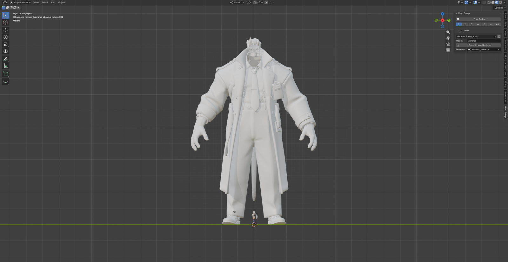

### Step 2: Character

Set **Rig** to `Miruko Rig`, then click **Clean Up Character Meshes**. It:

- deletes the geometry that the suit/tights/gloves Mask modifiers were hiding (shape keys are kept),
- drops empty Armature modifiers,
- removes 3,000+ vertex groups left over from an older rig,
- turns bone-parented meshes into weighted ones.

Meshes that are hidden from renders (here the alternate NSFW parts) are left out of the fit
and the export.

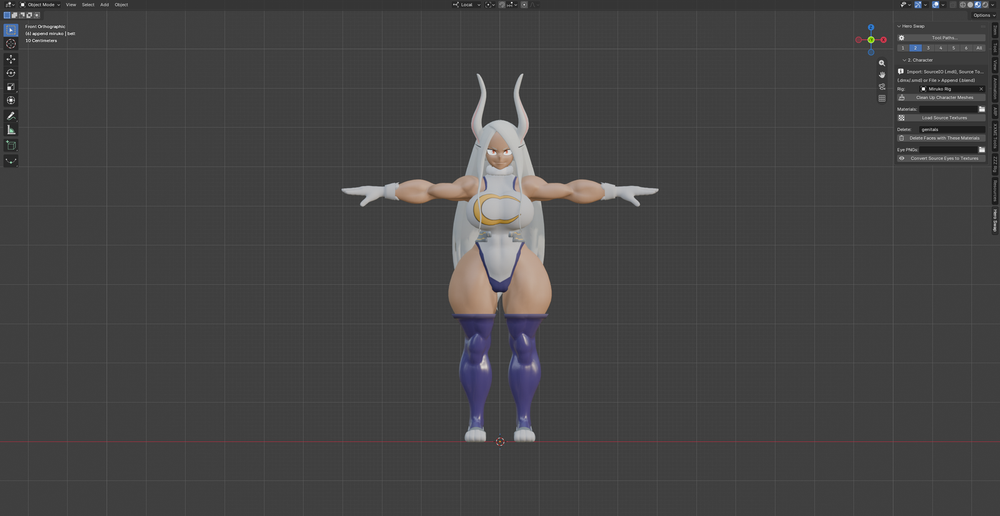

The other buttons in this step are for SFM models (Example B):

- **Load Source Textures**
- **Delete Faces with These Materials**
- **Convert Source Eyes to Textures**

### Step 4: Bone map

Click **Auto-detect Bone Map**. Every joint is matched from names and the hierarchy:

- Miruko's `hips`, `spine`, `chest` and `neck` → Abrams' `pelvis`, `spine_0..3` and `neck_0`.
- Her deforming forearm bone is `Elbow.L`, not the non-deforming `forearm.L`, and it was picked correctly.
- IK, pole and facial-panel bones are skipped.
- Her two spine bones are spread over Abrams' four.

Use the **Character bones / Hero bones** switch to check either side. Click a bone to change
it, then click **Save Bone Map**. The map is written as JSON next to the .blend.

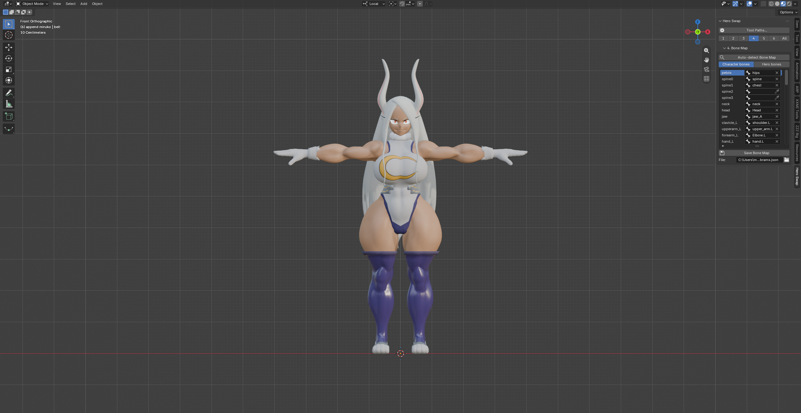

### Step 5: Fit

Click **Fit Character to Hero**. Miruko is scaled to Abrams' shoulder height and posed into his
bind pose. Her weights are renamed to his bones, and everything is parented to his skeleton.
The hero's own bones are never changed.

With **Keep Jiggle Bones** on, her hair, ears, chest, butt and tail chains stay as real bones,
so they can get physics. The fit also renames them to Source 2-safe names (`AC_hair_A.L` →
`AC_hair_A_L`).

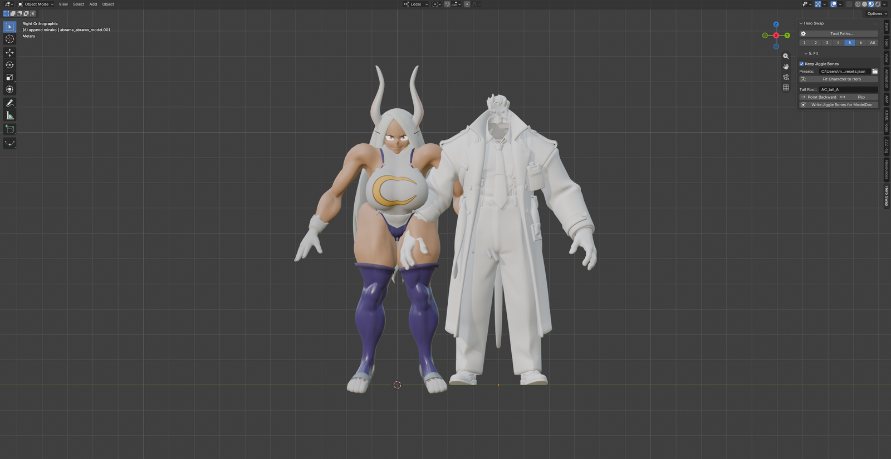

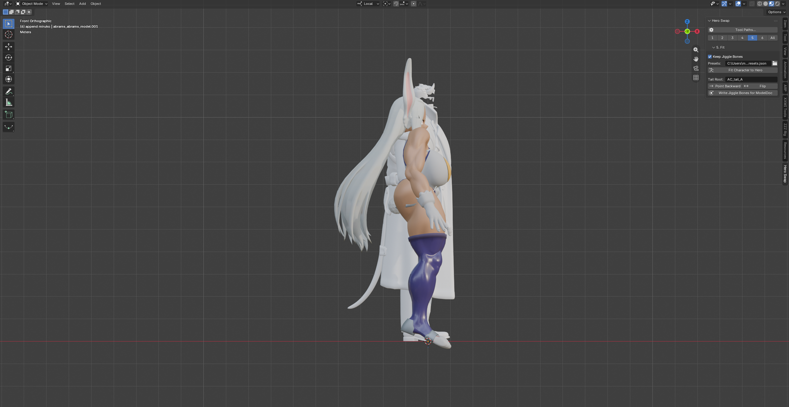

If a tail comes out sideways, use **Point Backward** and then **Flip** on the Tail Root (the
fit fills in the Tail Root for you).

### Step 6: Export + Build

1. Set **Addon** (for example `abrams_miruko`), **Skin Folder** (`miruko`) and **Pak** (`31`).
2. Click **Export Model + Materials**. It writes the following into
   `<CSDK>/content/citadel_addons/<addon>/`:
   - each material's textures as PNGs and a Deadlock `.vmat`,
   - `materials.json`, the remap list,
   - `jiggle_bones.vmdl.txt`,
   - the ModelDoc DMX.

   A mesh with no material gets a plain one, so it doesn't show up as an error material.
3. Click **Build + Install Mod**. This runs locally:
   1. compiles the materials with the CSDK,
   2. rewrites the hero `.vmdl`: swaps in your mesh, keeps the weapons, keeps LOD 0, and adds the
      material remaps and JiggleBoneList,
   3. compiles the model with CS2 Workshop Tools,
   4. packs `pak31_dir.vpk` and copies it into `game/citadel/addons`.

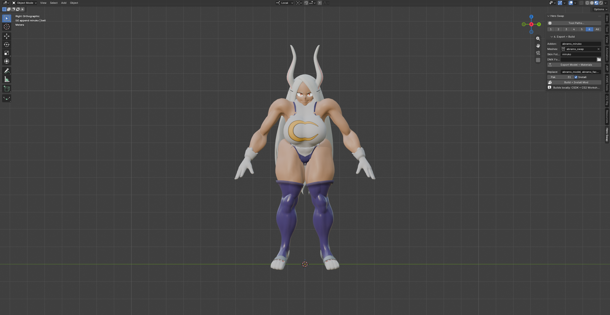

---

## Example B: Krystal (.mdl) wearing the Nightmare Moon outfit → Pocket

Krystal is a compiled SFM model on a Valve biped rig. The ReVAmped V4 Nightmare Moon outfit
was made for the VA anthro body on a different rig. So the outfit has to move to Krystal's
skeleton first, and then onto her much curvier body.

**Import:** use File > Import > Source Engine assets (SourceIO) for three things:

- Krystal's `krystalv2.mdl`,
- the outfit's `revamped_v4_nmm_outfit_plantigrade.mdl`,
- the body the outfit was made for, from the MLP V4 Anthros source files:
  `bodyparts/anthro/bodies/ReVAmped_body_base_sfw.dmx`. Import this one with File > Import >
  Source Engine (Source Tools), with nothing selected.

### Step 2: Character

- **Load Source Textures**, with **Materials** set to Krystal's `materials` folder. SourceIO
  looks textures up case-sensitively, and this mod's folders (`Fursonas/Starfox`, `1_Body.vtf`)
  don't match the paths inside the model (`fursonas/StarFox`, `1_body`), so it left her grey.
  This button finds every `.vmt` and `.vtf` regardless of case.
- **Delete Faces with These Materials** with `genitals`, on the body mesh.
- **Convert Source Eyes to Textures**, on the body mesh. Source 2 has no EyeRefract shader,
  so the iris projection is baked into the eyeball UVs.

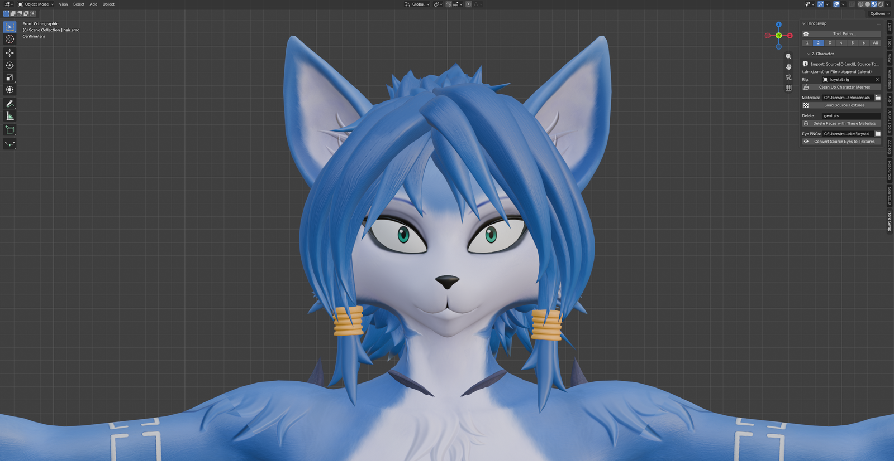

### Step 3: Outfit made for another body

1. Select the VA body, tick **Merge onto Outfit Rig instead**, and click **Bone-merge Selected
   onto Character**. This puts the original body on the outfit's rig, and fixes the
   inch/metre difference between Source Tools and SourceIO.
2. Set **Outfit Rig** (the outfit's armature), **Its Body** (the VA body) and **New Body**
   (Krystal's body mesh).
3. Click **Fit Outfit to Character**:
   1. The outfit rig is mapped onto Krystal's rig with the same auto-detection as step 4, and the
      outfit is posed onto her skeleton.
   2. The VA body is morphed onto Krystal's body: nearest points, smoothed so nothing folds.
   3. Every outfit piece is carried along with **Surface Deform**, so each garment keeps its own
      shape over the skin under it, even where Krystal's chest is much bigger than the VA body's.
   4. Anything still under her skin is pushed out by **Gap**.
   5. Tight pieces take her skin weights (**Copy Body Weights**), so they bend exactly like the body.
4. Click **Delete Skin Under Outfit**. It pushes skin that pokes through the cloth back under it,
   and deletes skin faces the clothes fully cover. Openings in the clothes, and see-through
   pieces like the translucent sleeves, keep their skin.

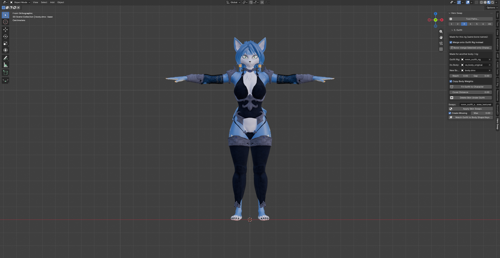

**Skin Swaps** swaps materials by name, for example
`nmm_outfit_sleeves=nmm_outfit_sleeves_textured` for the outfit's second skin. **Match Outfit
to Body Shape Keys** makes the outfit follow the body's sliders.

### Steps 1, 4 and 5: Hero, bone map, fit

1. Pick **pocket (hero_synth)** and click **Import Hero Skeleton**. The replaced meshes are
   `pocket` and `coat_scarf`. The gun, briefcase and frog are kept.
2. Click **Auto-detect Bone Map**. Krystal's `bip_` rig maps without edits. Pocket has no jaw
   bone, so her jaw rides with the head.
3. Click **Fit Character to Hero**.

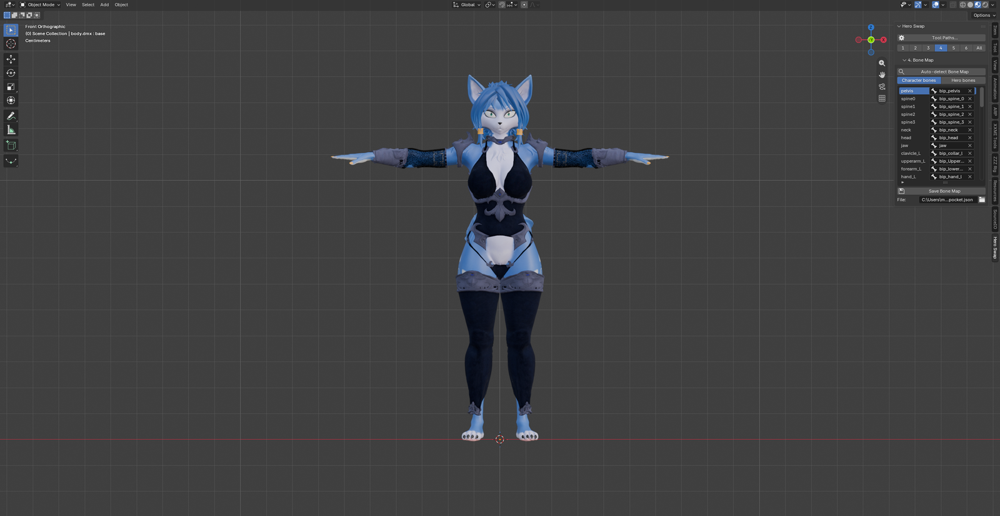

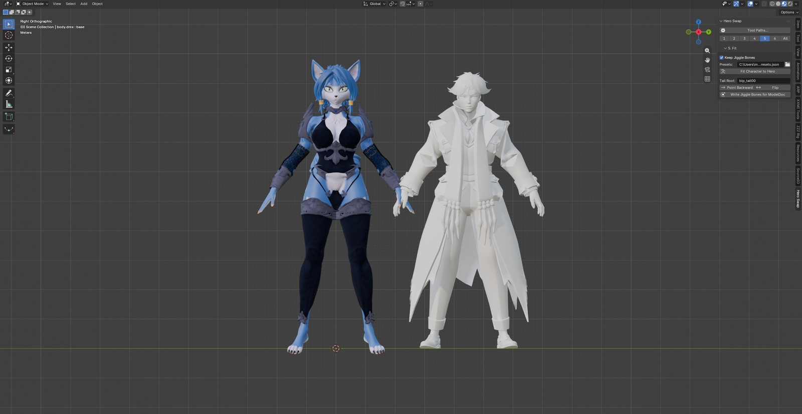

Her tail, hair, ears, chest and butt chains are kept as 55 jiggle bones. The tail comes
straight out the back:

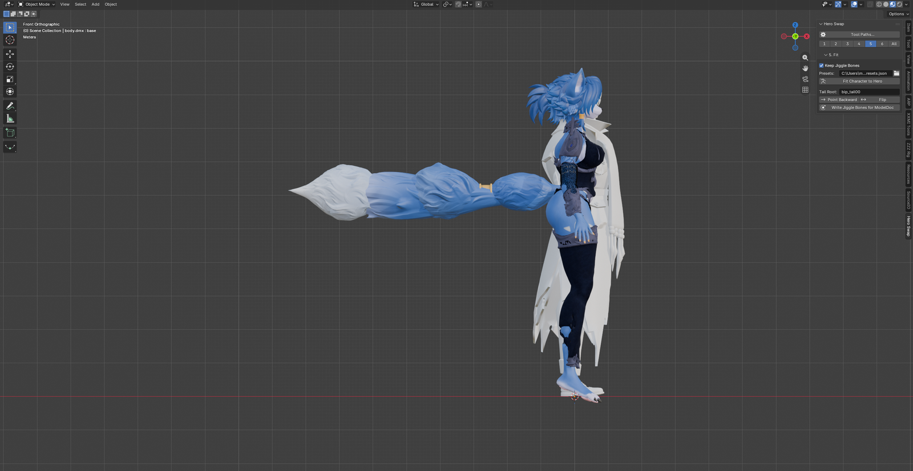

### Step 6

Export and build as in Example A (addon `pocket_krystal`, pak `32`).

---

## Reference

### What each button does

| Step | Button | What it does |
|---|---|---|
| 1 | **Import Hero Skeleton** | Extracts the hero with Source 2 Viewer, imports its body DMX, and fills in the meshes to replace. |
| 2 | **Clean Up Character Meshes** | Deletes Mask-hidden geometry, fixes empty Armature modifiers and bone parenting, and removes vertex groups that aren't bones. |
| 2 | **Load Source Textures** | Finds untextured materials' `.vmt`/`.vtf` files, ignoring case, and wires up base colour, normal map and alpha. |
| 2 | **Delete Faces with These Materials** | Deletes faces by material name (NSFW parts, extras). |
| 2 | **Convert Source Eyes to Textures** | Bakes SourceIO's projected EyeRefract iris into the eyeball UVs and a PNG. Run it before the fit. Iris textures with or without an alpha mask both work. |
| 3 | **Bone-merge Selected onto Character** | Moves an outfit made for the same rig onto it by bone name, matching units. |
| 3 | **Fit Outfit to Character** | Moves an outfit made for another rig and body onto the character (see Example B). |
| 3 | **Delete Skin Under Outfit** | Stops skin from showing through clothes. |
| 3 | **Apply Skin Swaps** / **Match Outfit to Body Shape Keys** | Material swaps, and making the outfit follow the body's sliders. |
| 4 | **Auto-detect Bone Map** / **Save Bone Map** | Builds the joint table, and writes the bone map JSON. |
| 5 | **Fit Character to Hero** | The fit. Shape keys and drivers are kept. |
| 5 | **Point Backward** / **Flip** | Fix a tail that comes out sideways or curls the wrong way. |
| 5 | **Write Jiggle Bones for ModelDoc** | Puts the JiggleBoneList in a text block and the clipboard. Export writes it for the build anyway. |
| 6 | **Export Model + Materials** | Writes PNGs, `.vmat`s, `materials.json`, the jiggle bones and the ModelDoc DMX into the CSDK addon. |
| 6 | **Build + Install Mod** | Local CSDK + CS2 compile, then VPK pack and install. |

### Building without Blender

**Build + Install Mod** saves its settings as
`<CSDK>/content/citadel_addons/<addon>/models/heroes_wip/<hero>/build_config.json`. To build
again from a terminal, for example after editing a `.vmat` by hand:

```
python tools/build_mod.py <path to build_config.json>
```

`config/example_build_config.json` shows every key.

### Bone maps

A bone map is JSON:

- `segments` are joint pairs that drive the fit: the source pair is posed onto the target pair. A
  fifth entry `"move"` only slides the joint, which is used for the spine and clavicles so the
  torso keeps its own shape. A target can be `"a..b@t"`, the point `t` of the way from joint a to b.
- `terminals` are end joints that only move and turn with their parent.
- `groups` renames vertex groups. Patterns use `fnmatch`, and `{Side}` / `{S}` expand to Left/L and Right/R.
- `pelvis`, `side_bones`, `height_bones` / `ground_bones` (or `scale_bones` for a rig without
  feet), `torso`, `torso_stop` and `torso_smoothing` tune the placement.

Bones that aren't mapped ride with their nearest mapped ancestor. An unparented bone (a tail,
a prop) rides with the nearest mapped bone. Auto-detect writes all of this for you.
`addon/hero_swap_tools/bonemap_va_anthro_to_deadlock.json` is a hand-tuned map for the VA rig.

### Jiggle presets

`addon/hero_swap_tools/jiggle_presets.json` has two parts:

- `keep_patterns` lists which source bones survive the fit as real bones. Patterns are case-insensitive.
- `presets` holds the ModelDoc JiggleBone fields for each pattern.

The defaults cover VA (`HairBack1`, `TailBase`), Valve biped (`bip_tail00`, `bip_breast_01_r`)
and Blender rigs (`AC_hair_A.L`, `Breast.L`, `AC_L_ear_A`). Tune the values in ModelDoc: open
the built `.vmdl` in CS2 Workshop Tools (Asset Browser).

### Installing and mod conflicts

The build copies `pakNN_dir.vpk` into `game/citadel/addons`. A lower pak number loads first and
wins, so if another mod replaces the same hero with a lower number, disable it in Deadlock Mod
Manager or pick a lower pak number.

### Headless scripts

`blender/01_import_sfm.py`, `02_fit_to_hero.py` and `03_export_dmx.py` run the original
config-driven batch flow for SFM models:

```
blender -b --python blender/01_import_sfm.py -- <config.json> work/01_import.blend
blender -b work/01_import.blend --python blender/02_fit_to_hero.py -- <config.json> <bonemap.json> <hero body dmx> work/02_fit.blend
blender -b work/02_fit.blend --python blender/03_export_dmx.py -- <config.json> <export folder>
```

Copy `config/example_hero_swap.json` to start a config.

### Known limits

- Only LOD 0 is shipped.
- Jiggle values are starting points from the SFM `.qci` files and need tuning.
- Materials guess roughness and metalness, except where the Blender material has textures for them.
- Source 2 can't do the SFM eyelens's additive reflection, so leave eyelens meshes out.
- Blender Source Tools runs Undo at the end of every export. That's fine when you click the
  button, but it stops scripts that drive Blender remotely (for example over MCP) until Blender
  is restarted.
