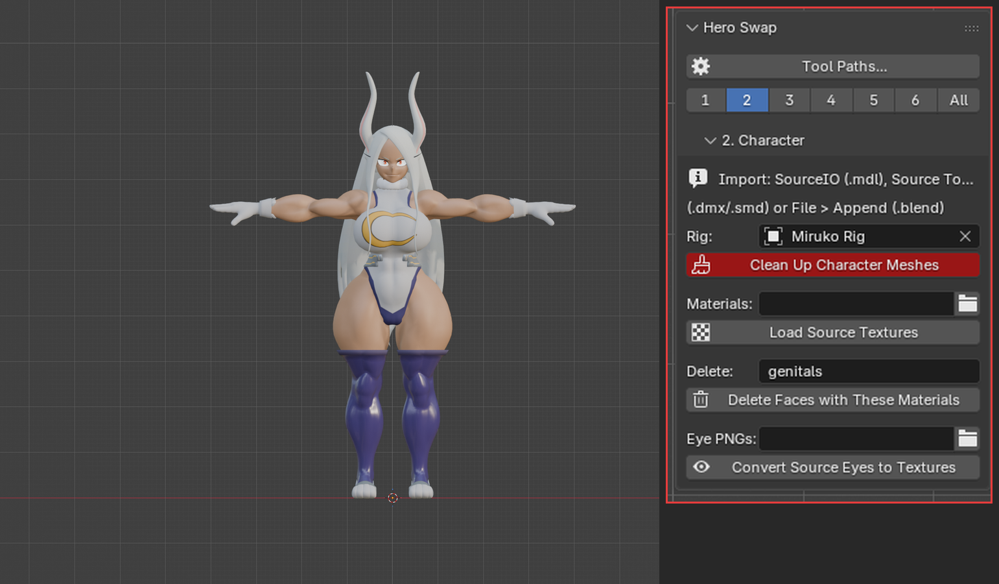
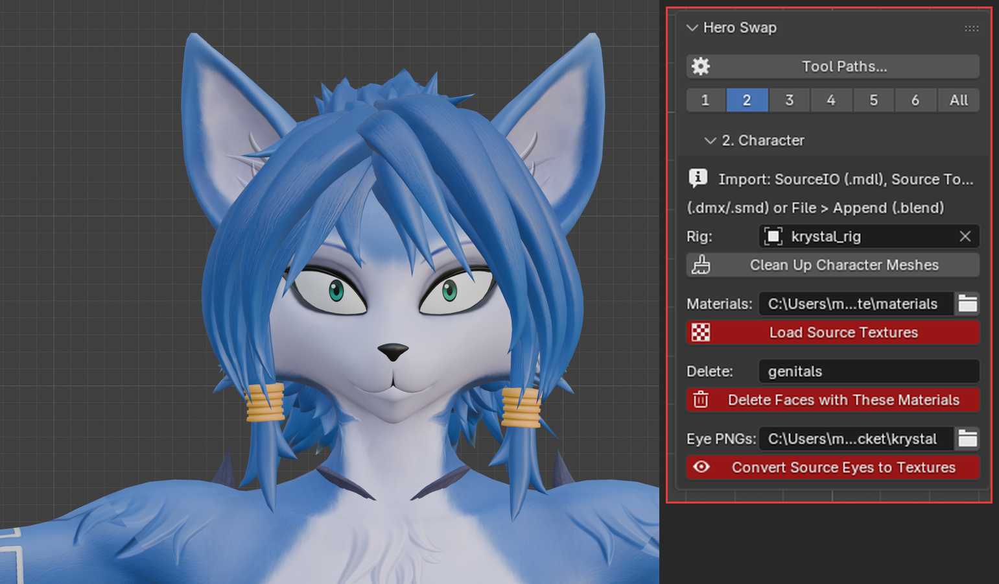
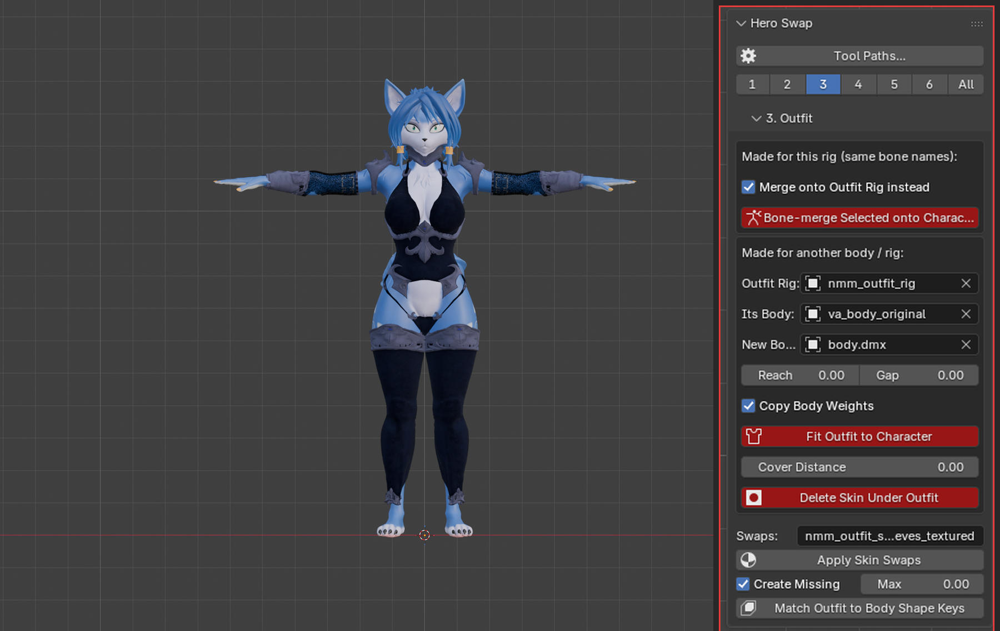
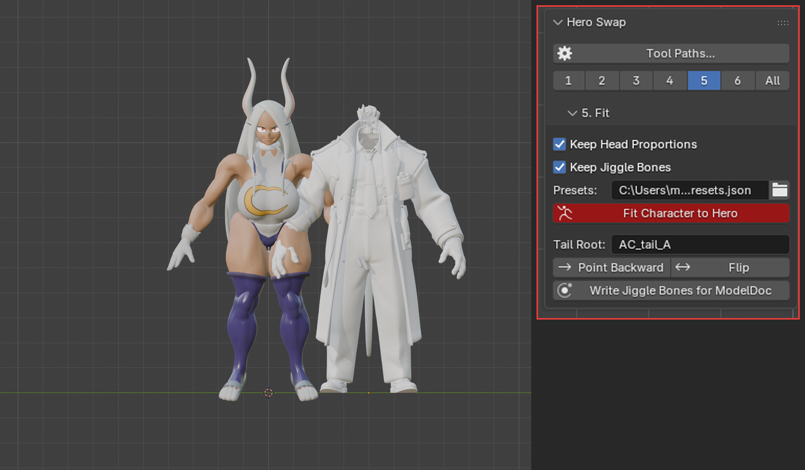
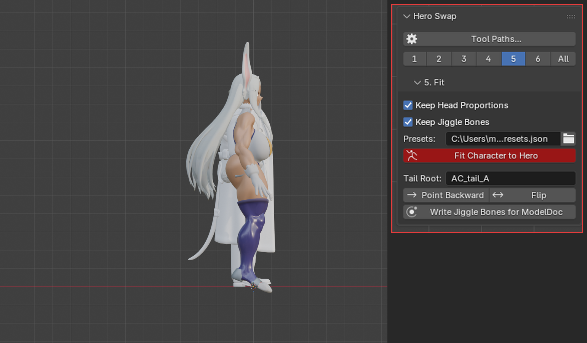
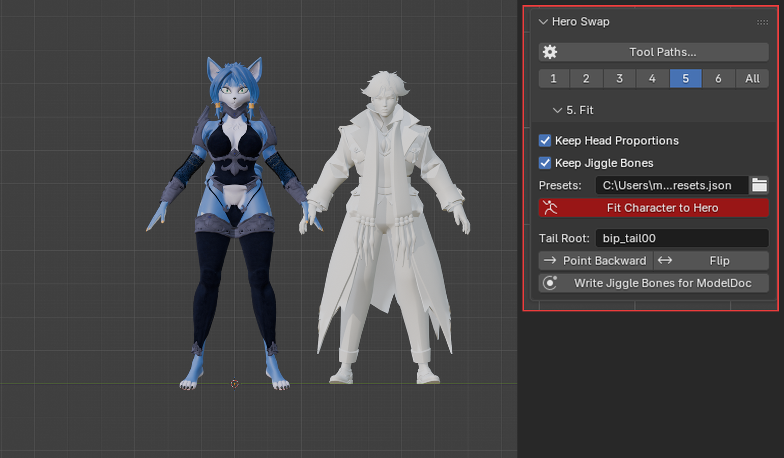
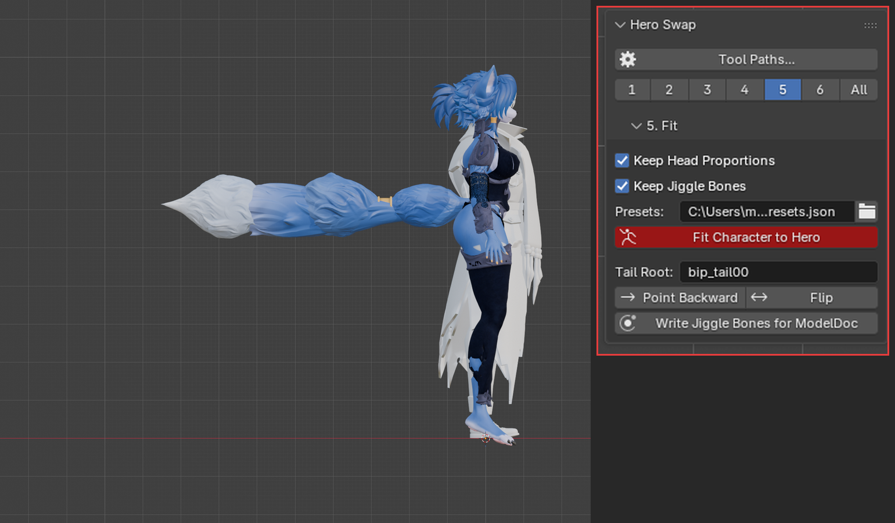
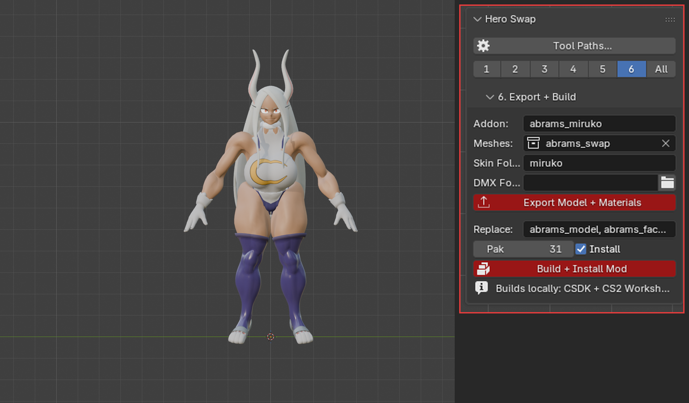

# Deadlock hero swap pipeline

Put any humanoid SFM or Blender character, with or without an outfit made for a different body,
onto any Deadlock hero. Everything happens in one Blender sidebar, and the mod is compiled,
packed and installed locally, with nothing compiled online.

The two examples in this guide are only illustrations: Miruko IK replacing Abrams, and Krystal
in the ReVAmped V4 Nightmare Moon outfit replacing Pocket. The same steps work for any hero and
any humanoid model. In the screenshots, the button used in each step is drawn **red**, and the
sidebar is shown enlarged on the right.

No game files or third-party model assets are included. Use only models you made or have
permission to use.

## Miruko / Abrams torso correction

The experimental source-proportion workflow fixes the compressed Miruko torso in the
saved Blender model and the tested Deadlock hideout pose. It retains source bone lengths
and drives their rotations from Abrams's animation skeleton.

**[Follow the illustrated Miruko correction guide](docs/miruko-abrams-proportions.md)**
for the before/after screenshots, fitting and export steps, measured results, and
remaining animation checks. Full combat animation and weapon-contact validation is pending.

## Outfit shape matching and semi-transparent materials

[Follow the general outfit and transparency tutorial](docs/outfit-shapes-transparency.md)
for matching an imported outfit to existing body proportions, merging its rig,
checking clothing clearance, correcting a tail, preserving jiggle bones and exporting
an Alpha-slider transparency test. It includes screenshots of the actual controls.

## 0. One-time setup

1. Install **Blender 5.2**, plus these add-ons (Edit > Preferences > Add-ons > Install):
   - [Blender Source Tools](https://github.com/Artfunkel/BlenderSourceTools), for DMX import and export.
     It needs a one-line fix on Blender 5: in `io_scene_valvesource/flex.py`, `addDrivers`, change
     `fcurve.modifiers.remove(fcurve.modifiers[0])` to
     `if len(fcurve.modifiers): fcurve.modifiers.remove(fcurve.modifiers[0])`.
   - [SourceIO](https://github.com/REDxEYE/SourceIO), for compiled SFM `.mdl` models.
   - `addon/hero_swap_tools` from this repo. Copy the folder into `%APPDATA%\Blender Foundation\Blender\5.2\scripts\addons`.
2. Get the local build tools:
   - [Source 2 Viewer CLI](https://github.com/ValveResourceFormat/ValveResourceFormat/releases), which reads the hero out of the game.
   - **Reduced CSDK 12**, which compiles materials with Deadlock's shaders.
   - **CS2 Workshop Tools**: in Steam, Counter-Strike 2 > Properties > DLC. These compile the model with AnimGraph 2.
3. In Blender, press **N** in the 3D Viewport, open the **Hero Swap** tab and click **Tool Paths...**. Set:
   - the Deadlock folder,
   - the Reduced CSDK folder,
   - the CS2 folder (`...\Counter-Strike Global Offensive`),
   - `Source2Viewer-CLI.exe`,
   - a work folder.

The row **1 2 3 4 5 6 All** under Tool Paths shows one step at a time.

## Where the pieces come from

| What | Where | How it gets into Blender |
|---|---|---|
| The hero (Abrams, Pocket, any other) | Your Deadlock install, `game/citadel/pak01_dir.vpk` | Step 1 picks it from a list read from the game's `heroes.vdata`, then extracts it with Source 2 Viewer. You don't need to unpack anything by hand. |
| An SFM character or outfit | A compiled `.mdl` with its `materials` folder (Workshop downloads, mod sites) | File > Import > Source Engine assets (SourceIO). |
| A source DMX/SMD (for example the body an outfit was made for) | The model's `sourcefiles` | File > Import > Source Engine (Source Tools), with nothing selected. |
| A Blender character | A `.blend` | Open it, then **File > Save As** a working copy. Save As keeps texture paths working; a copy made in Explorer breaks them (pink textures). |

The list shows each hero's display name and its internal model name, for example
`Abrams (abrams)`, `Pocket (pocket)`, `Celeste (unicorn)`. Names come from the game's own
localization files.

## Step 1: Hero

Pick the hero and click **Import Hero Skeleton**. The add-on:

- extracts `models/heroes_wip/<hero>/<hero>.vmdl` and its meshes,
- imports the skeleton, with the hero's own mesh hidden for reference,
- fills in which hero meshes the mod replaces. The body, face, hair and coat are replaced;
  weapons and ability props are kept.


## Step 2: Character

Set **Rig** to your character's armature, then use whichever buttons your model needs:

| Button | Use it when |
|---|---|
| **Clean Up Character Meshes** | The character was made in Blender: Mask modifiers, empty Armature modifiers, bone-parented parts, leftover vertex groups. Meshes hidden from renders (alternate or NSFW parts) are left out automatically. |
| **Load Source Textures** | An SFM model came in grey. SourceIO looks textures up case-sensitively. Point **Materials** at the model's `materials` folder. |
| **Delete Faces with These Materials** | Remove parts by material name (for example `genitals`). Select the mesh first. |
| **Convert Source Eyes to Textures** | SFM eyes (EyeRefract). Source 2 can't project them, so they're baked into UVs. Run it before the fit. |





## Step 3: Outfit (optional)

- **The outfit was made for the character's rig** (same bone names): select its meshes and
  click **Bone-merge Selected onto Character**.
- **The outfit was made for another body or rig**, like the Nightmare Moon outfit, which was
  made for the VA anthro body and here goes on Krystal:
  1. Import the body it was made for. Select that body, tick **Merge onto Outfit Rig instead**,
     and click **Bone-merge Selected onto Character**.
  2. Set **Outfit Rig**, **Its Body** and **New Body** (your character's skin mesh).
  3. Click **Fit Outfit to Character**. The outfit is posed onto the character's skeleton, the old
     body is morphed onto the new one, and the outfit is carried along with Surface Deform. Tight
     pieces take the skin's weights.
  4. Click **Delete Skin Under Outfit**. It removes skin the clothes fully cover, and pushes skin
     that pokes through back under the cloth. Openings, see-through pieces, and the neck and head
     are left alone.
- **Skin Swaps** swaps materials by name (`old=new`). **Match Outfit to Body Shape Keys** makes
  the outfit follow the body's sliders.



## Step 4: Bone map

Click **Auto-detect Bone Map**. It finds pelvis, spine, neck, head, jaw, arms, legs and fingers
on both rigs from names and the hierarchy. Tested on Blender/Rigify, Valve biped (`bip_`),
VA/ReVAmped and Deadlock rigs; IK, pole and control bones are skipped.

Check the table with the **Character bones / Hero bones** switch. Fix any row by picking a bone,
then click **Save Bone Map**.


## Step 5: Fit

For the original fitting mode, click **Fit Character to Hero**. The character is scaled to the hero's shoulder height and posed
into the hero's bind pose. Weights are renamed to hero bones, and everything is parented to the
hero skeleton. The hero's bones are never changed.

- **Keep Head Proportions** (on by default): if the hero carries the head low, as Abrams does,
  the character's head stays at its own height above the shoulders instead of sinking into the
  torso. It only ever raises a head, never lowers it.
- **Keep Jiggle Bones**: hair, ear, chest, butt and tail chains stay as bones, so they can get
  physics. The patterns are in `jiggle_presets.json`.
- **Point Backward** / **Flip**: use these if a tail comes out sideways or curls the wrong way
  (the fit fills in the Tail Root).









## Step 6: Export + Build

1. Set **Addon** (any name), **Skin Folder**, and **Pak**. A lower pak number loads first, so it
   wins over other mods for the same hero.
2. Click **Export Model + Materials**. It writes PNG textures, Deadlock `.vmat` files, the jiggle
   bones and a ModelDoc DMX into `<CSDK>/content/citadel_addons/<addon>/`.
3. Click **Build + Install Mod**. Everything runs on your PC:
   1. compiles the materials (CSDK),
   2. rewrites the hero `.vmdl`: your mesh in, the hero's body out, weapons kept, material remaps
      and jiggle bones added,
   3. compiles the model (CS2 Workshop Tools),
   4. packs `pakNN_dir.vpk` and copies it into `game/citadel/addons`.



To build again from a terminal (for example after editing a `.vmat`):

```
python tools/build_mod.py <CSDK>/content/citadel_addons/<addon>/models/heroes_wip/<hero>/build_config.json
```

`config/example_build_config.json` lists every key.

## Reference

- **Bone map format:**
  - `segments` are joint pairs that are posed onto the target's (a fifth entry `"move"` only slides the joint).
  - `terminals` are end joints that only move and turn with their parent.
  - `groups` renames vertex groups (`fnmatch` patterns; `{Side}` and `{S}` expand to Left/L and Right/R).
  - `head_anchor`, `pelvis`, `side_bones`, `height_bones` / `ground_bones` or `scale_bones` tune the placement.

  Unmapped bones ride with their nearest mapped ancestor.
- **Mod conflicts:** if another installed mod replaces the same hero with a lower pak number,
  disable it in Deadlock Mod Manager or pick a lower number.
- **Headless scripts:** `blender/01_import_sfm.py`, `02_fit_to_hero.py` and `03_export_dmx.py`
  run the older config-driven batch flow (see `config/example_hero_swap.json`).
- **Known limits:**
  - Only LOD 0 is shipped.
  - Jiggle values and material roughness are starting points.
  - Leave SFM eyelens meshes out.
  - Source Tools runs Undo after each export. That's fine when you click the button, but it stops
    scripts that drive Blender remotely until Blender is restarted.
