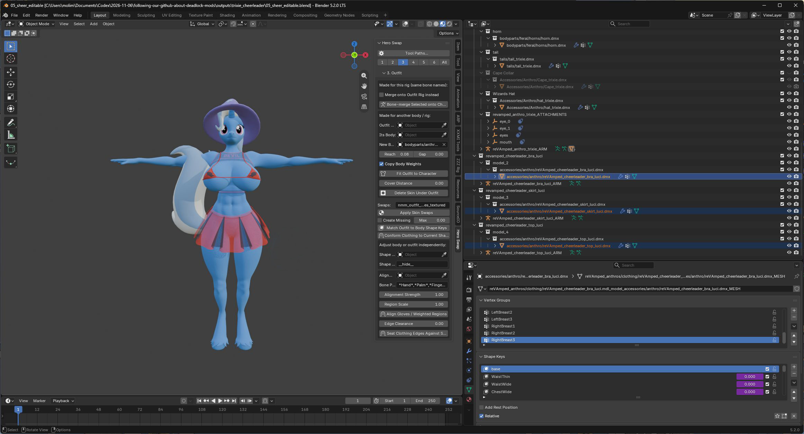
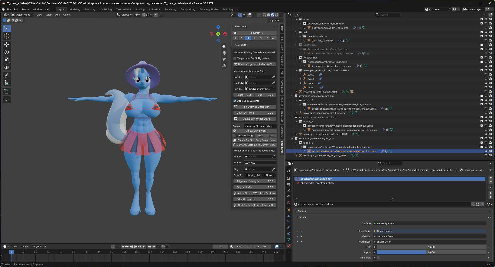
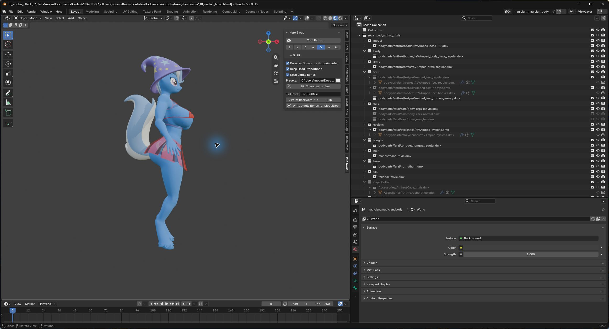
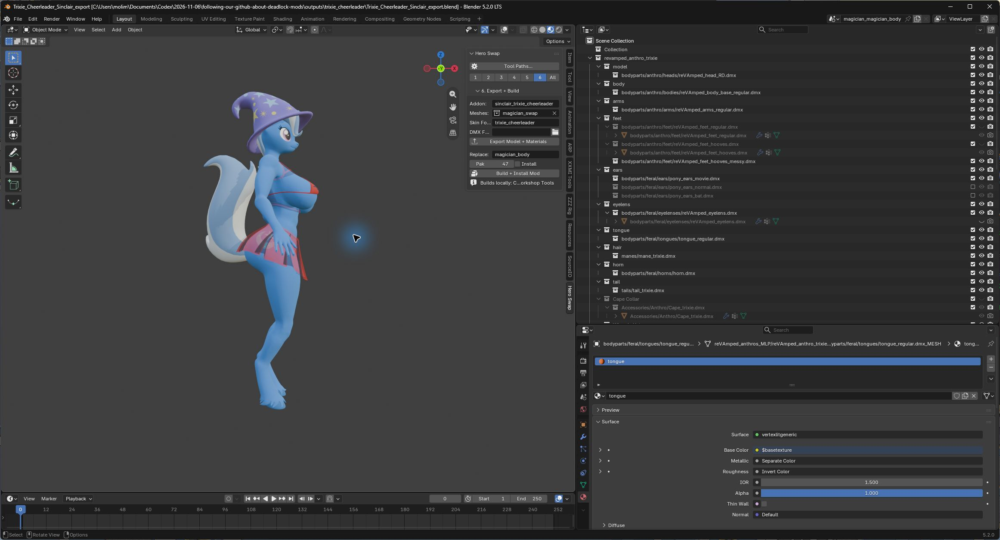
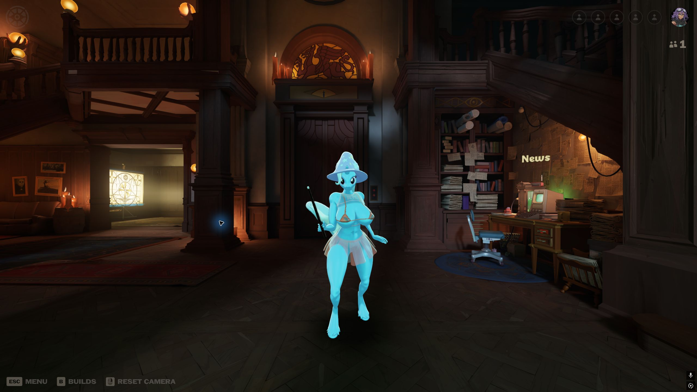
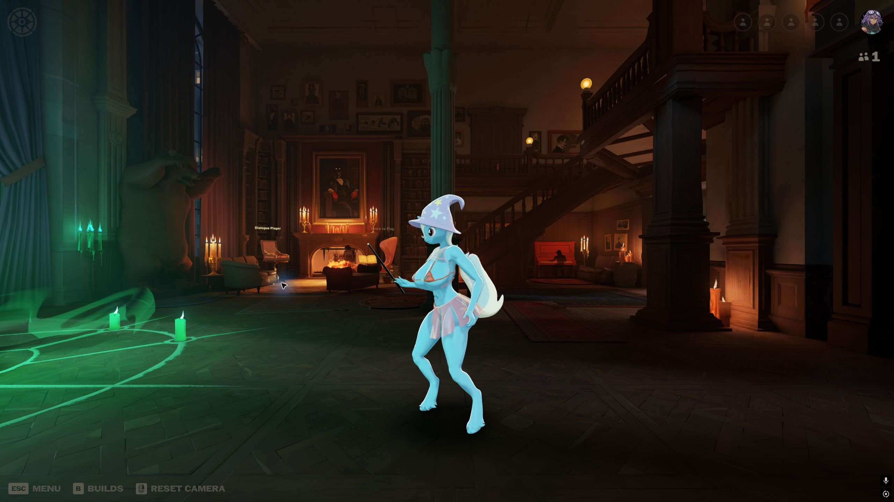

# Fitting an outfit and testing transparency

The [main guide](../README.md#step-3-outfit-optional) covers the click order. This page is
the long version, using a real build: an imported ReVamped cheerleader bra, top and skirt on
Trixie, replacing Sinclair — and semi-transparent fabric in the outer layers.

Assume the character's body proportions are already what you want. Outfit fitting shapes
cloth to a body; it is not a place to fix a body.

Requires the add-on in this repository — **Conform Clothing to Current Shape** and exporting
an unlinked material **Alpha** are newer than the original tool. Compilers and add-on
locations: [one-time setup](../README.md#0-one-time-setup). The screenshots are actual
captures of the Blender interface; labels are spelled out in the text where the sidebar
truncates them.

## 1. Save the scene and pick the right fields

Save a new `.blend` before fitting. Keep an editable checkpoint after fitting, and make a
third copy for export. Never fit over the only copy of someone's model.

Press **N** in the 3D Viewport → **Hero Swap** → **2 / Character**, and set **Rig** to the
character's armature. Then in **3 / Outfit**, set **New Body** to her complete skin mesh.
Two different fields, two different jobs: an armature supplies bones, a mesh supplies shape
keys and the surface clothing clearance measures against.

Leave the body shape values alone. Hide alternate feet, ears, outfits and duplicate parts —
and exclude them from rendering/export too, not just the viewport. This build keeps the
imported messy hoof variant and the hat. Source eye-lens meshes are excluded; select the
head and use **Convert Source Eyes to Textures** before exporting SourceIO eyes.

## 2. Match shape keys, then merge the outfit

For an outfit authored against the same ReVamped skeleton:

1. Select only the outfit meshes — body unselected.
2. In **3 / Outfit**, click **Match Outfit to Body Shape Keys** (shape-key icon). Leave
   **Create Missing** off at first when the outfit already has matching controls; matching
   names get linked to the body's values.
3. Click **Bone-merge Selected onto Character** (armature icon), with **Merge onto Outfit
   Rig instead** off. Garments now follow the character's armature while staying separate,
   editable objects with their own materials.
4. Walk around the result. Matching names are not a fit guarantee — different topology or
   slightly different original proportions will still miss.
5. Set **Reach** and **Gap**, then click **Conform Clothing to Current Shape**. It checks
   the currently evaluated body and clothing surfaces, pushes intersecting cloth outward,
   and applies the same correction to the shape keys. It does not reshape the body. Run it
   in the rest pose, with topology-changing modifiers applied first.

The example linked 41 existing keys across three garments, using source-space clearance
`0.003` with reach `0.08`. Those are Blender scene units — scale them to your character. And
**Gap** will happily display `0.00` in a narrow panel while holding a nonzero value; click
the field to see its real precision.

Worth knowing: clearance pushes intersections **outward**. It will not pull a loose skirt
against the skin or invent a missing panel, so check open edges and layer-on-layer
intersections by hand. Changed the shape sliders afterwards? Run the fit check again. Save
before you bake shapes.

For an outfit built for a different rig, use the **Outfit Rig / Its Body / New Body** +
**Fit Outfit to Character** route instead — and don't treat matching bone names as proof
that two skeletons share rest positions.

## 3. Make the outer layer see-through

1. Select the outer garment, then open **Material Properties** (material sphere icon on the
   Properties editor's vertical strip).
2. Select a material slot. If an opaque underlayer uses the same material, duplicate it
   first — editing a shared material changes every mesh using it.
3. Under **Surface**, with a Principled BSDF, set **Alpha** to `0.45` for the test. An
   unlinked Alpha slider is the supported constant-opacity path (`1.0` opaque, `0.0` gone).
4. Under **Settings / Surface**, set **Render Method** to **Blended** (Blender 5.2 wording),
   and inspect in Material Preview or Rendered view.
5. Repeat for the garment's other slots. Here the top and skirt go translucent and the bra
   underlayer stays opaque.

Keep the skin under translucent cloth — **Delete Skin Under Outfit** is the wrong tool for
areas meant to be visible through the fabric. View layered transparency from several angles;
sorting and apparent opacity can differ from a single flat sheet, and Blender's preview is
not the final game shader.

On the export side, the tool writes `F_TRANSLUCENT` plus a separate `TextureTranslucency1`
opacity texture for Deadlock's `pbr.vfx`; in this constant-alpha workflow that texture holds
the slider value. An RGBA colour texture on its own does not feed that shader input, and
arbitrary procedural Alpha node networks are not baked.

## 4. Fit to the hero and fix the tail

1. Pick the hero in **1 / Hero** and **Import Hero Skeleton** — **Sinclair (magician)** here.
   In **4 / Bone Map**, auto-detect, inspect the result, save it.
2. In **5 / Fit**, enable **Preserve Source Proportions (Experimental)** and **Keep Jiggle
   Bones**. Use a clean hero skeleton, and fit once per pre-fit checkpoint.
3. For this ReVamped rig, point **Presets** at
   [jiggle_revamped_single_springs.json](../config/jiggle_revamped_single_springs.json): one
   breast and one buttock spring per side, plus hair and tail chains. The remaining
   deformation bones stay in the rig. It is not a universal preset — review names per model.
4. Click **Fit Character to Hero**. The added `CV_` deformation bones keep source lengths
   while following hero rotations; details in
   [proportions, heel shoes and weapon grip](proportions-heel-shoes-and-weapon-grip.md).
5. Set **Tail Root** to the root of the whole tail chain — `CV_TailBase` here — then click
   **Point Backward** (arrow icon) and check from the side and behind. Use **Flip** only if
   the curl really is upside down.
6. Re-check clothing in the hero's rest pose. New arm and leg rotations can introduce
   clipping even after a clean source-space fit; select the garments and run **Conform
   Clothing to Current Shape** again with Reach and Gap rescaled to the new size.

The post-fit check here initially found 30 top and 60 skirt vertices more than 0.1 mm inside
the body (measured back in source scale); a second clearance pass cleared those measured
intersections. That is a vertex-versus-surface check — it does not prove every triangle, or
every animated frame, stays clear.

The example retains 15 jiggle bones: two breast, two buttock, four hair, seven tail. The tail
root is a stable attachment, not an extra spring. **Write Jiggle Bones for ModelDoc** shows
the settings, and export writes them automatically. Stacking independent springs through
every breast tip is a good way to watch tight cloth come unaligned — test before you trust it.

## 5. Export and build

Save the editable fitted file, then make a separate export copy and bake the shape mix there
if you don't need runtime flexes. Keep the complete body for the transparent layers, and
don't join meshes just to merge rigs — the export collection accepts several clothing
objects sharing one skeleton.

In **6 / Export + Build**:

1. Give **Addon** and **Skin Folder** unique names and tick the **Meshes** collection.
2. Check **Replace**: hero body meshes only, weapons and ability props kept. This Sinclair
   build replaces `magician_body`.
3. Click **Export Model + Materials** (export arrow icon).
4. Pick an unused **Pak** number. Leave **Install** unchecked if Deadlock Mod Manager handles
   installation, then click **Build + Install Mod** (package icon).
5. Import the VPK into your existing mod-manager profile with **Add Local Mod**, replacing
   only the older package for this hero. Keep unrelated mods enabled, keep a restore copy,
   and restart Deadlock.

That export carries `proportion_constraints.kv3`, the jiggle settings, material remaps,
textures and DMX, and the builder merges the orientation drivers into the hero's existing
constraint list. A clean compile tells you the files are valid — nothing about animation or
transparency in-game.

## What was validated

The example exported 13 meshes, 20 materials and 15 jiggle bones with the saved body shape
values unchanged, and the final rest-pose test found no garment vertex more than 0.1 mm
inside the body once hero scale was normalised.

The compiled package was loaded on Sinclair in the Deadlock hideout. Front and side
inspection confirmed visible transparency in the outer top and skirt, the retained opaque
bra, the wand, and the tail sitting behind the character across several idle poses.

Individual physics regions and full combat animations were not exhaustively tested — this is
a transparency demonstration, not an animation certification. Only the existing
Trixie/Sinclair package was replaced, and hash comparison confirmed every other installed VPK
(including Sunset Shimmer for Celeste) was untouched. The model compiler reported a
single-LOD warning and completed without compile failures.

Local working files live under `outputs/trixie_cheerleader/` and are not committed:

| File | Purpose |
|---|---|
| `01_user_imported_original.blend` | Untouched imported scene |
| `08_prefit_editable.blend` | Fitted clothing, original proportions, editable shape controls |
| `10_sinclair_fitted.blend` | Editable hero fit, tail correction and jiggle setup |
| `Trixie_Cheerleader_Sinclair_export.blend` | Baked export copy |
| `Trixie_Cheerleader_Sinclair.vpk` | Compiled game package |
| `previous_Trixie_bunny_restore.vpk` | Previously installed package, for rollback |

Third-party models and generated VPKs stay local; the workflow, screenshots, preset, code
and measurements are what's shared here.

Related: [jiggle bones and presets](jiggle-bones-and-presets.md) ·
[proportions, heel shoes and weapon grip](proportions-heel-shoes-and-weapon-grip.md) ·
[the agent runbook](../AGENTS.md)
