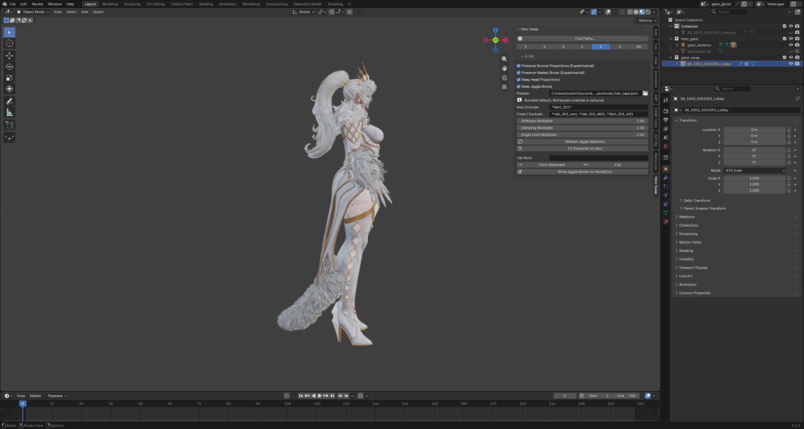
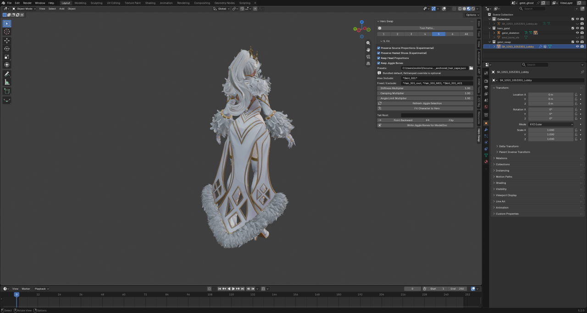
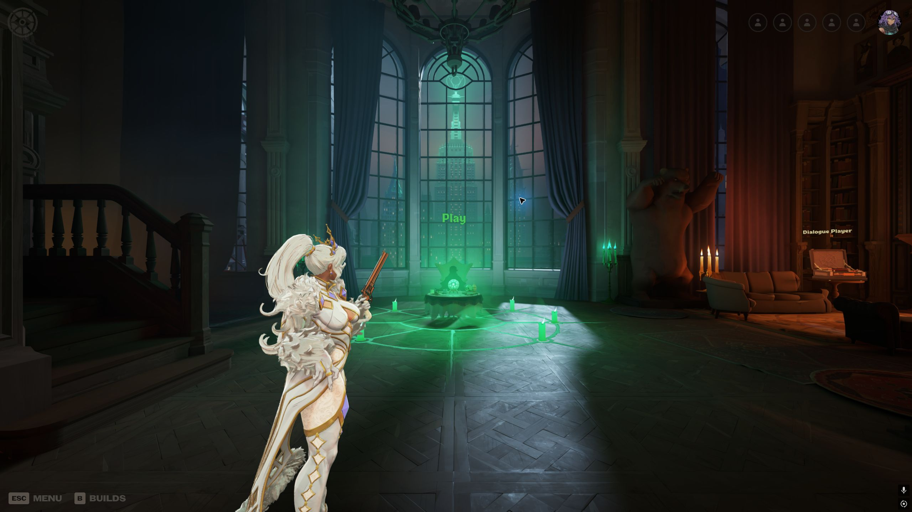

# Jiggle bones, presets and tuning

Secondary motion — hair, capes, skirts, tails, ears, breasts — and the presets that decide
which of those bones actually get physics. The screenshots show the real controls; the
character in them is just an example, not a required model or naming convention.

If you only want the default behaviour, enable **Keep Jiggle Bones** and stop reading: the
bundled `jiggle_presets.json` is already selected. Everything below is for when the default
is wrong for your rig.



## Which preset to use

**The bundled `jiggle_presets.json` is the default, and ReVamped is optional.**

- [Bundled default](../addon/hero_swap_tools/jiggle_presets.json) — broad hair, tail, breast,
  butt, and ear patterns across several naming conventions. Start here.
- [ReVamped override](../config/jiggle_revamped_single_springs.json) — for matching ReVamped
  rigs; deliberately picks one breast/butt spring per side so motion doesn't stack. Not
  required for other models.
- A custom JSON — when bone names differ, or for skirt chains. The bundled keep list does
  *not* explicitly select skirts, so add patterns for the chains that are actually weighted.

One thing people get wrong: an external JSON **replaces** the default; it does not merge
with it. Older scenes also remember whichever path they were saved with, so check the
**Presets** field again after moving a project between machines.

Each JSON holds `keep_patterns` plus physics `presets`. Matching is case-insensitive and
**the first matching rule wins** — which is how a `skip` rule keeps an attachment in the rig
without giving it its own spring (`TailBase` is the usual example).

**Keep Jiggle Bones** retains eligible bones during a normal fit. In experimental
proportion mode, deformation-relevant bones are retained on their own, and the preset still
chooses which of them export as jiggle. Neither mode invents missing chains or paints
weights — if the bones aren't there, refit from a clean source with the right keep patterns.

## 1. Find the bones that actually move the mesh

Select the mesh and look at **Object Data Properties → Vertex Groups**. Select a candidate
group in Edit Mode (or use Weight Paint) to see which vertices it owns, and read the
armature hierarchy too. A bone called `Cape` might belong to an unused outfit — a name is
not evidence.

In this example, the cape panels and bottom fur are driven by `L/M/R_Skirt_301` chains. The
source *also* has Cape and Cloak bones with no weights on this mesh at all. The scalp hair
hangs off `Hair_301_root`, which is an attachment, not a swinging segment.

## 2. Keep the attachment fixed

A hair root should follow the head. A cape's attachment should follow its existing chest,
shoulder or waist parent — don't detach roots or reparent a waist-mounted panel to the
shoulders just because it looks cape-like.

In **5. Fit**, enable **Keep Jiggle Bones** and pick a preset. The bundled default is a
starting point; a custom JSON replaces it. Here the
[anchored hair/cape preset](../config/jiggle_anchored_hair_cape.json) fixes the scalp, the
first ponytail segment and the first segment of each cape chain. Do not copy those exact
bone names onto another model without checking its hierarchy and weights.

**Fixed / Exclude** takes comma-separated patterns:

```text
*Hair_301_root, *Hair_301_M01, *Skirt_301_A01
```

Excluding physics doesn't delete bones or weights — they just keep following their parent.
A JSON rule with `"skip": true` does the same thing. Put specific skip rules *before* broad
ones, because the first match wins.

## 3. Add or remove moving segments

**Also Include** adds patterns to the preset's `keep_patterns`, e.g. `*Skirt_301*`.

Click **Refresh Jiggle Selection**, then open `jiggle_selection.txt` in Blender's Text
Editor to see the exact active names. Matching covers both source names and the exported
`CV_`-prefixed names, and exclusions beat inclusions.

On a proportion rig, the refresh searches the retained replacement `CV_` bones and avoids
the native hero hair; in the older fitting mode it searches the already-retained jiggle
list. It cannot recreate bones or weights that a previous fit removed — that means going
back to clean source and refitting.

The exporter refreshes selection too, so tuning physics no longer means running
**Fit Character to Hero** again on an already-fitted mesh.

## 4. Adjust the motion

There is no single "strength" knob. Start at multiplier 1.0 and change one thing at a time:

| Control | Effect |
|---|---|
| **Stiffness Multiplier** | Higher resists bending; lower gives a softer response |
| **Damping Multiplier** | Higher reduces oscillation and settling time; too much reads as sluggish |
| **Angle Limit Multiplier** | Lower allows less angular travel; 0 locks angular range where the preset supplies a limit |

These multiply the selected preset's values without rewriting its JSON, and they apply to
**all** selected physics bones — not just hair. To tune hair and cape separately, copy the
preset and edit their individual rules.

A flexible hair rule might look like:

```json
{
  "pattern": "*Hair_301*",
  "fields": {
    "jiggle_type": 1,
    "has_base_spring": 0,
    "tip_mass": 8,
    "yaw_stiffness": 250,
    "pitch_stiffness": 250,
    "yaw_damping": 12,
    "pitch_damping": 12,
    "has_angle_constraint": 1,
    "angle_limit": 8,
    "along_stiffness": 100,
    "along_damping": 8
  }
}
```

That's a restrained starting point, not a prescription. Angle limits are **per segment**, so
long chains still accumulate a lot of travel. Base springs allow translation — keep them off
for hair and cape attachments, and note that the angle multiplier does not scale
base-spring translation limits. Mass, base travel and per-region settings stay in the JSON.

Please don't judge any of this with Blender cloth simulation: Source 2 jiggle is evaluated in
the game, and cloth sim is not evidence of it.

## 5. Export, rebuild, compare

Click **Write Jiggle Bones for ModelDoc** and read `jiggle_bones.vmdl`: the fixed roots
should be absent and the intended moving segments present. Then **Export Model + Materials**
and **Build + Install Mod**. Leave **Install** unchecked if Deadlock Mod Manager handles
installation, import the new VPK, and disable only the older version it replaces. Restart
Deadlock so the rebuilt resources actually load.



Capture a neutral/rest reference first, then compare idle, turns, running and abrupt stops.
Watch the scalp seam, the collar and waist attachments, cape edges and fur. If a whole part
drifts away from its attachment, that's root physics or weights — check those before
reaching for stiffness. If an anchored chain swings too much, cut travel and add damping in
small steps. None of these bones guarantee cloth/body collision.

## In the game



Related: [fitting outfits and transparency](fitting-outfits-and-transparency.md) ·
[proportions, heel shoes and weapon grip](proportions-heel-shoes-and-weapon-grip.md) ·
[the agent runbook](../AGENTS.md)
