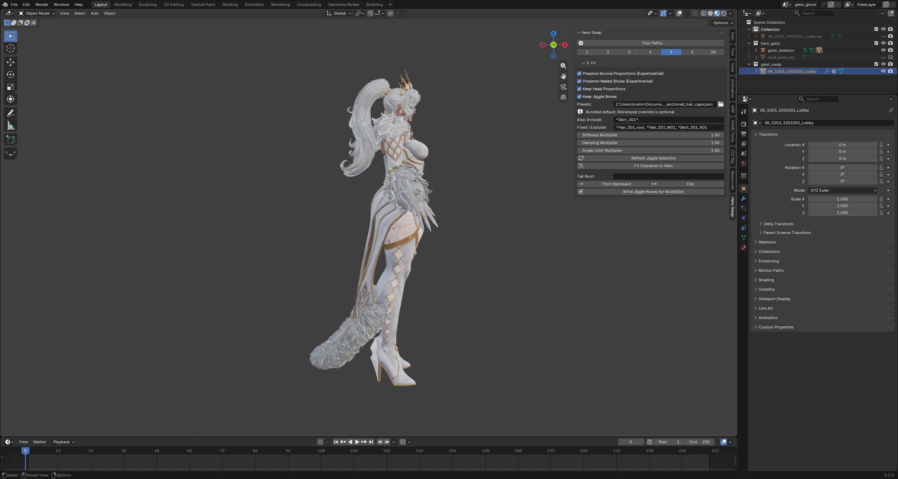
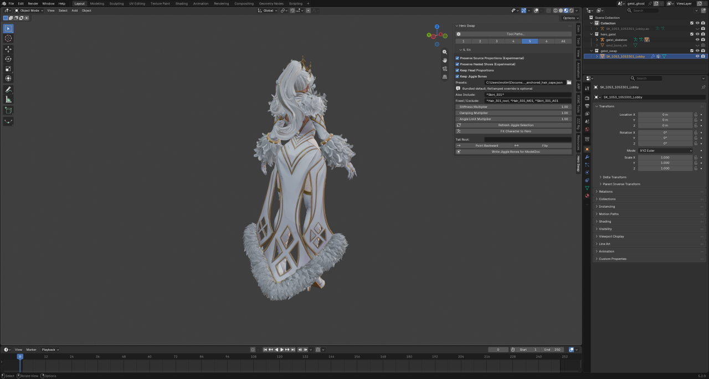
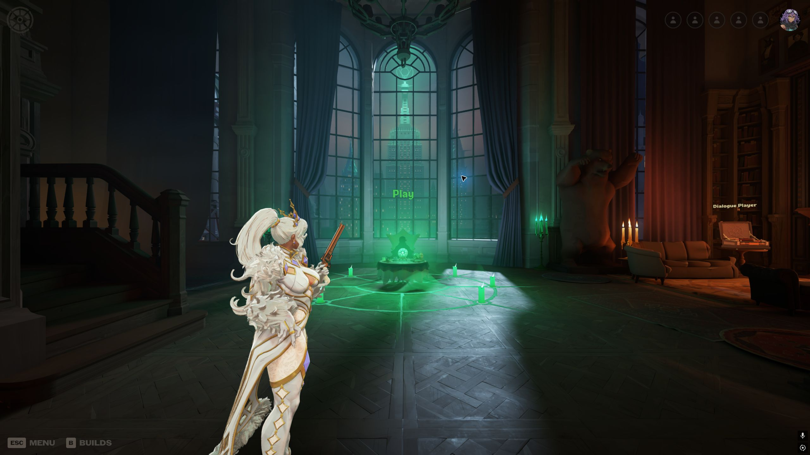

# Choosing and tuning jiggle bones

Use this workflow for hair, capes, skirts, tails or other weighted secondary-motion
chains. The screenshots show actual controls; the character is an example, not a
required model or naming convention.



## 1. Find the bones that actually move the mesh

Select the mesh and inspect **Object Data Properties > Vertex Groups**. Select a
candidate group in Edit Mode to see its vertices, or use Weight Paint. Inspect the
armature hierarchy as well. A bone named Cape may belong to an unused outfit; names
alone do not establish that it controls the visible cape.

In this example, the cape panels and bottom fur use `L/M/R_Skirt_301` chains. The
source also contains Cape and Cloak bones, but none has weights on this mesh.
The scalp hair uses `Hair_301_root`; that is an attachment, not a swinging segment.

## 2. Keep the attachment fixed

A hair root should follow the head. A cape's attachment should follow its existing
chest, shoulder or waist parent. Do not detach roots or reparent a waist-mounted
panel to the shoulders just because it resembles a cape.

In **5 / Fit**, enable **Keep Jiggle Bones** and choose a preset. The bundled default
is a starting point. A custom JSON replaces it. For this example the
[anchored hair/cape preset](../config/jiggle_anchored_hair_cape.json) fixes the scalp,
first ponytail segment and first segment of each cape chain. Do not use these exact
bone names on a different model without checking its hierarchy and weights.

**Fixed / Exclude** accepts comma-separated patterns, for example:

```text
*Hair_301_root, *Hair_301_M01, *Skirt_301_A01
```

Excluding physics does not delete bones or weights. They continue following their
parent. A JSON rule with `"skip": true` also excludes physics. Put specific skip
rules before broad rules: the first matching rule wins.

## 3. Add or remove moving segments

**Also Include** adds patterns to the preset's `keep_patterns`, for example:

```text
*Skirt_301*
```

Click **Refresh Jiggle Selection**. Open `jiggle_selection.txt` in Blender's Text
Editor to inspect the exact active names. The controls match both source names and
exported names with the `CV_` prefix. Exclusions take precedence over inclusion.

For a proportion rig, refresh searches retained replacement `CV_` bones and avoids
native hero hair. For the older fitting mode it searches the already-retained
jiggle list. It cannot recreate missing bones or weights: return to the clean source
and refit with the appropriate keep patterns if those chains were removed.

The exporter refreshes selection automatically too. Changing physics no longer
requires running Fit Character to Hero again on an already-fitted mesh.

## 4. Adjust motion

There is no single universal "strength" setting. Start at multiplier 1.0 and change
one property at a time:

| Control | Effect |
|---|---|
| **Stiffness Multiplier** | Higher resists bending; lower allows a softer response |
| **Damping Multiplier** | Higher reduces oscillation and settling time; very high damping can feel sluggish |
| **Angle Limit Multiplier** | Lower allows less angular travel; 0 locks angular range where the preset supplies a limit |

These multiply values in the selected preset without overwriting its JSON. They
apply to all selected physics bones, not just hair. To tune hair and cape separately,
copy the preset and edit their individual rules. Pattern matching is case-insensitive.

For example, a flexible hair rule might contain:

```json
{
  "pattern": "*Hair_301*",
  "fields": {
    "jiggle_type": 1,
    "has_base_spring": 0,
    "tip_mass": 8,
    "yaw_stiffness": 250,
    "pitch_stiffness": 250,
    "yaw_damping": 12,
    "pitch_damping": 12,
    "has_angle_constraint": 1,
    "angle_limit": 8,
    "along_stiffness": 100,
    "along_damping": 8
  }
}
```

This is a restrained starting point, not a universal prescription. Angle limits are
per segment, so long chains can still accumulate considerable motion. Base springs
allow translation: keep them off for hair/cape attachments. The angle multiplier
does not scale base-spring translation limits. Mass, base travel, and per-region
settings remain in the JSON. Do not use Blender cloth simulation as evidence of
Source 2 jiggle behavior; these settings are evaluated in the game.

## 5. Export, rebuild and compare

Click **Write Jiggle Bones for ModelDoc** to inspect `jiggle_bones.vmdl`. Confirm the
fixed roots are absent and the intended moving segments are present. Then use
**Export Model + Materials**, followed by **Build + Install Mod**. Leave Install
unchecked for Modlock, import the new VPK, and disable only its older conflicting
version. Restart Deadlock to load the rebuilt resources.



Capture a neutral/rest reference and compare idle, turns, running and abrupt stops.
Watch the scalp seam, collar/waist attachment, cape edges and fur. If the whole part
moves away from its attachment, check root physics and weights before increasing
stiffness. If an anchored chain oscillates too much, reduce travel and increase
damping in small steps. These bones do not guarantee cloth/body collision.

## Validation record

The example export contains 34 active springs: 19 hair, 13 cape and two existing
breast springs. Scalp/ponytail and cape attachment segments are excluded. A Blender
head-rotation check preserved the hair-root transform relative to the replacement
head to about 0.000013 matrix-element error. Unit tests cover selection refresh,
exclusion, prefix matching, skip precedence and multiplier export without changing
the original preset. All five automated tests passed; the VPK compiled with zero
failures. The rebuilt package was imported through Modlock and loaded in Deadlock.
In the observed hideout idle views, the scalp and ponytail remained attached and
the cape hung from its attachment. Running, abrupt stops and combat have not been
validated; these screenshots are not a full animation or collision acceptance test.


