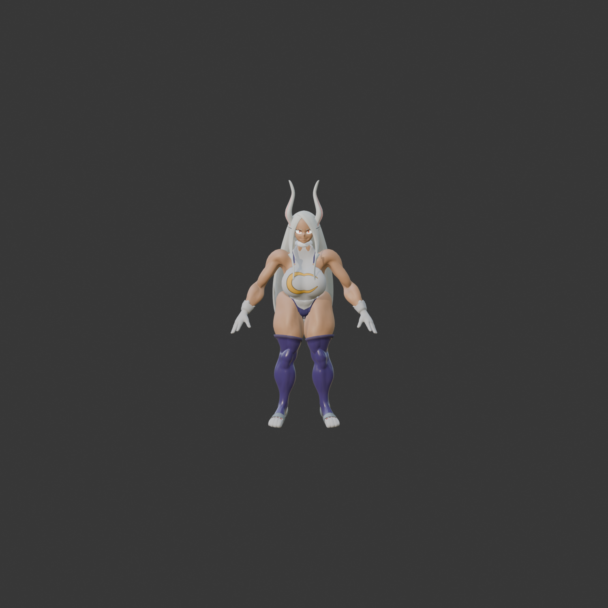
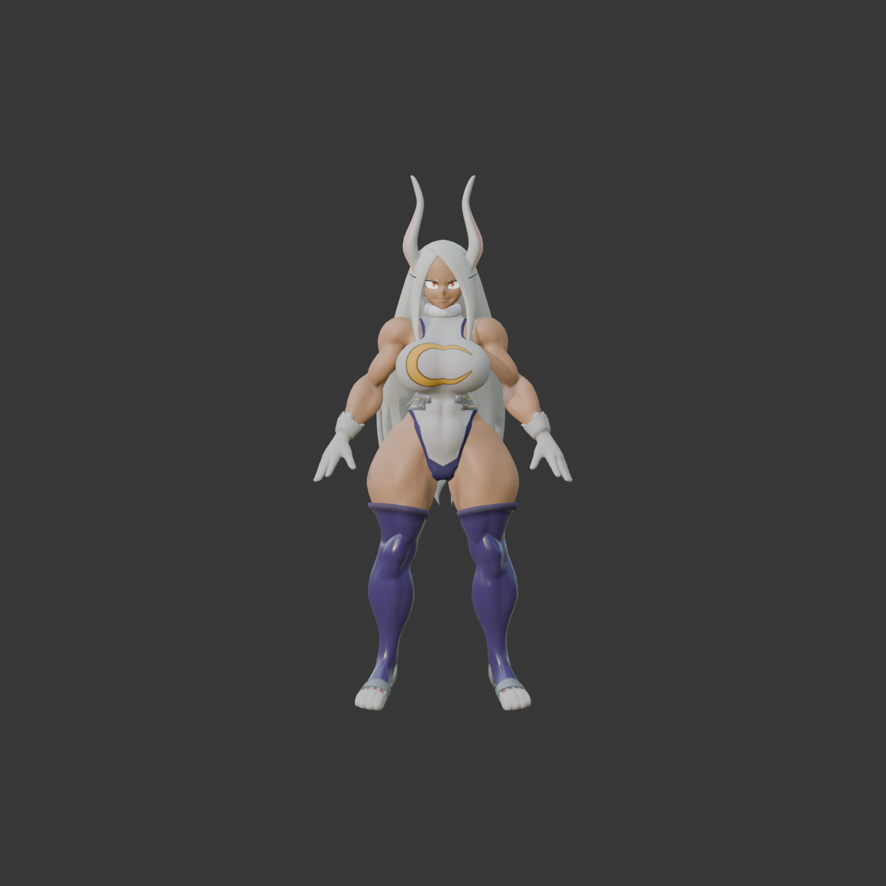
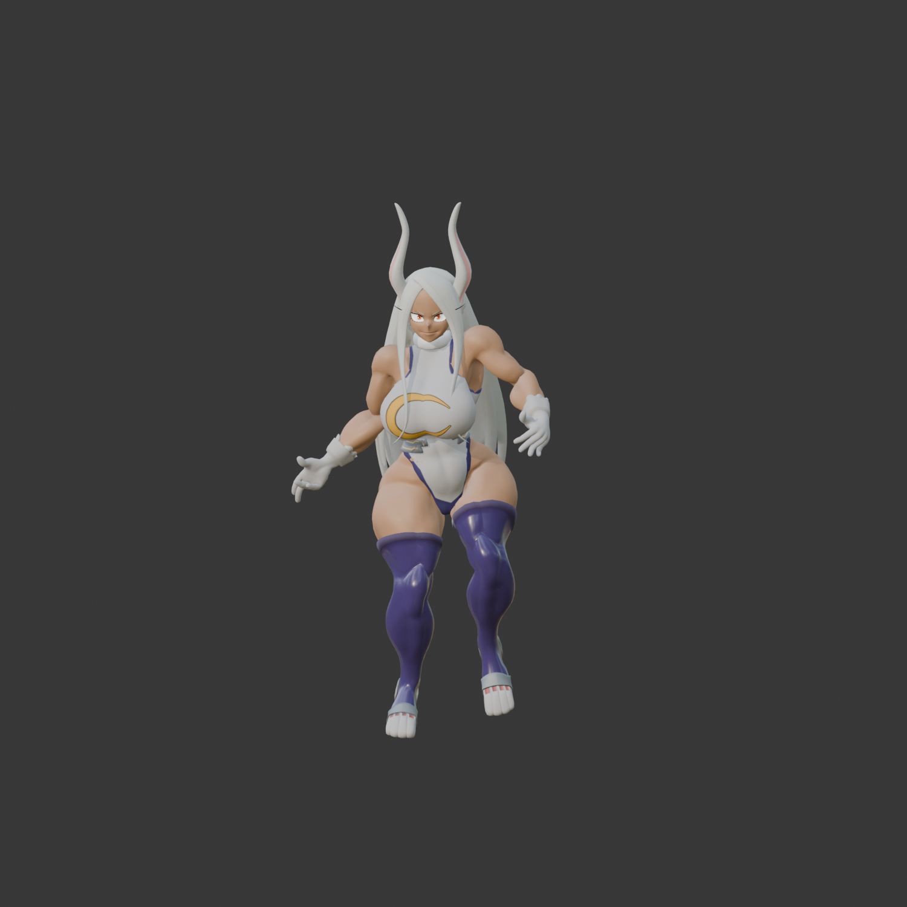
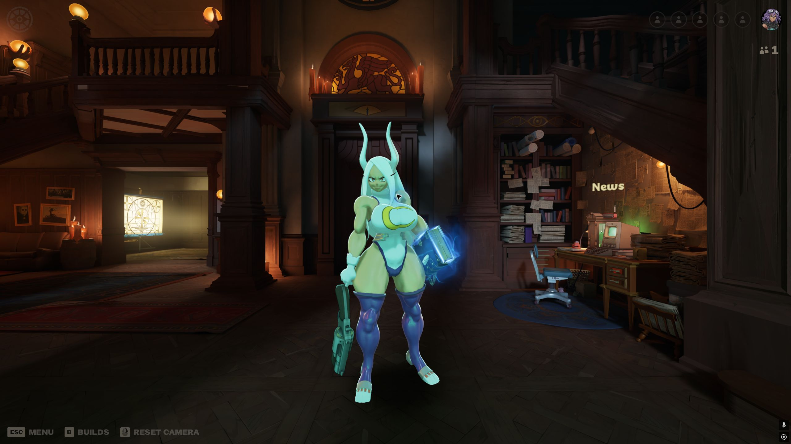
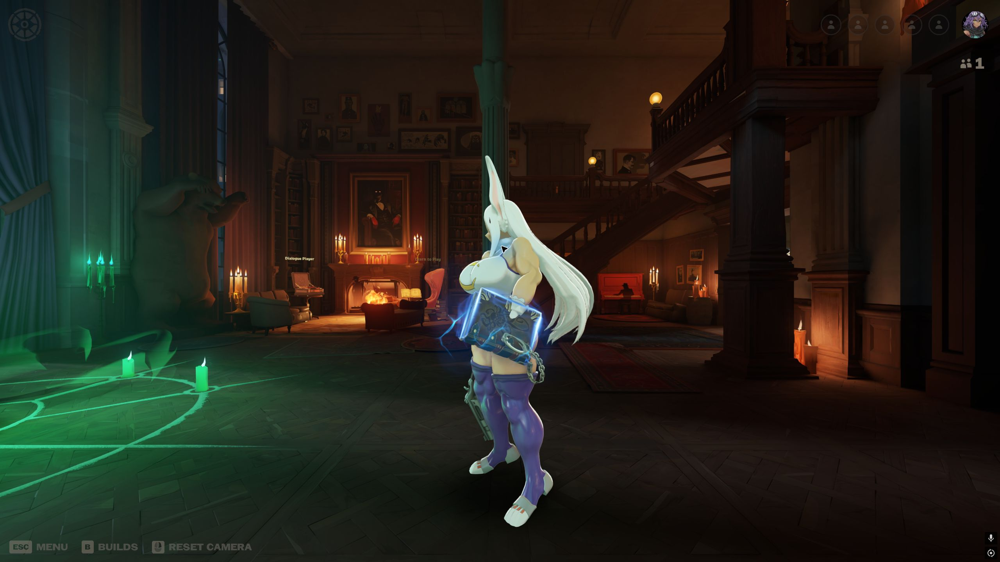

# Miruko on Abrams: correcting the compressed torso

The source-proportion fit corrects Miruko's crushed waist in the saved Blender model
and the tested Deadlock hideout pose. It retains her source skeleton's lengths after
uniform scaling, while a separate deformation skeleton follows Abrams's rotations.
This is experimental: full locomotion, abilities, weapon contacts and animation
transitions have not yet been validated.

## What changed

The original fit moves the character's joints onto the hero's joints. Abrams's short,
hunched torso compresses Miruko's waist when those positions are imposed directly.
The new fit keeps a separate `CV_` deformation hierarchy with source segment lengths.
Abrams's original skeleton and animation graph remain in place. The added bones follow
hero rotations through ModelDoc orientation constraints; they do not copy the shorter
hero segment translations. This changes retargeting, not the game's animation clips
or gameplay collision bounds.

Before:



Corrected rest pose:



## Repeat the correction

1. Install this branch's `addon/hero_swap_tools` folder and restart Blender. Follow
   [the setup instructions](../README.md#0-one-time-setup) for Source Tools, the local
   compilers and tool paths. Updating only the guide will not add the new fitting mode.
2. Open the original Miruko project or a clean pre-fit checkpoint. **Save As a new
   working file.** Enabling the option on an already compressed mesh cannot restore
   the original shape. Use a fresh Abrams skeleton; a second fit onto existing `CV_`
   bones is rejected to prevent duplicate deformation rigs.
3. Choose **Abrams** in Step 1 and import his skeleton. In Step 2, choose Miruko's
   character rig and clean up the character meshes. Exclude alternate outfits and
   hidden parts from export.
4. In Step 4, load/check the Miruko bone map. Verify pelvis, spine, chest, neck,
   shoulders, elbows, hands, thighs, knees, feet and fingers against both rigs.
   Missing torso rows are not a reason to squash the mesh onto Abrams's spine.
5. In Step 5, enable **Preserve Source Proportions (Experimental)** and **Keep Jiggle
   Bones**, then click **Fit Character to Hero** once. This uses the separate source-length
   rig. The older **Preserve Torso Proportions** option is a different fitting experiment;
   it is not the mode used for the results here.
6. Inspect front and side views, then preview an Abrams animation in Blender. Check
   the waist, shoulders, elbows and knees. Also inspect hand/weapon and foot contacts:
   preserving lengths does not guarantee those contacts for every animation.
7. Save the fitted `.blend` separately from the pre-fit file. In Step 6, export the
   model and materials. The exporter writes `proportion_constraints.kv3` alongside
   the model and the builder includes it through `build_config.json`.
8. Build the VPK. The builder must merge these constraints into the hero's existing
   **single** `AnimConstraintList`. An additional separate list compiled in our test
   but left the replacement in its rest pose in-game. The included regression test
   checks that original and added constraints share one list.
9. Import the VPK through Deadlock Mod Manager's **Add Local Mod** flow in your existing
   profile. Replace only an older Miruko/Abrams entry if it conflicts. Leave unrelated
   mods, including Sunset Shimmer for Celeste, enabled. Restart Deadlock after changing
   the installed package and inspect the actual loaded character.

## Evidence from this build

The Miruko build added 205 deformation bones and 53 orientation drivers. The runtime
model retained the hero's eight existing constraints, giving 61 constraints in one list.
The saved Blender running-pose preview is shown below; this is a preview, not proof
of gameplay locomotion.



The fitted rig preserved all 16 measured mapped segment lengths after uniform scaling.
The maximum relative error was `7.063509258609102e-7` (about `0.000071%`). See the
[individual segment measurements](miruko_proportion_validation.json).

The first runtime inspection exposed 16 unweighted vertices: two in the body and
14 in the tail. They produced stretched triangles. The fitter now repairs isolated
unweighted vertices from the nearest weighted neighbour and reports the repairs.
Wholly unweighted parts fall back to pelvis attachment. Review those repairs rather
than treating nearest-neighbour weights as intentional skinning.

Corrected hideout front and side views:




The corrected package was imported and inspected in the hideout. Hair motion was
observed. The legacy `hero_testing` map crashed; the current `dl_midtown` map loaded
on a local server through team selection. Testing ended before active gameplay.
The map crash does not establish that the replacement model caused it.

Before calling this a fully validated release, test walking, running, crouching,
jumping, melee, firing, all Abrams abilities and transitions between them. Check
feet, weapon grip, shoulder deformation and secondary motion in each case. A length
measurement or a good hideout pose cannot establish those results.

## Saved local checkpoints

The working session keeps these under `outputs/miruko_abrams/`:

| File | Purpose |
|---|---|
| `Miruko_clean_prefit.blend` | Clean source checkpoint for refitting |
| `Miruko_Abrams_driver_test.blend` | Corrected fitted/export model |
| `Miruko_Abrams_animation_preview.blend` | Saved Blender animation preview |
| `Miruko_Abrams_driver_test.vpk` | Package used for the corrected hideout inspection |
| `driver_report.json` | Bone mapping, scale, driver and weight-repair report |
| `proportion_constraints.kv3` | Runtime orientation drivers |

The guide, screenshots and implementation are shared in GitHub. Third-party model
files and the generated VPK are kept locally, not bundled into this source repository.

Run the build regression checks from the repository root:

```powershell
python -m unittest discover -s tests -p test_modeldoc.py
```
