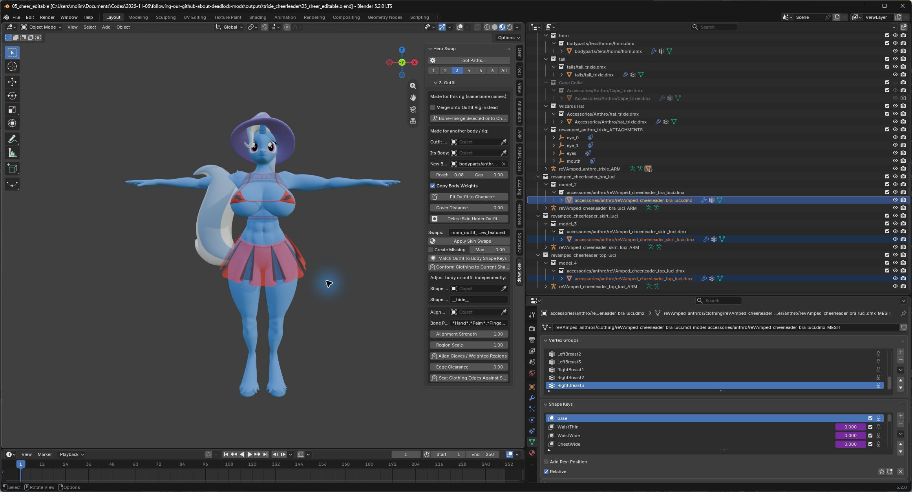
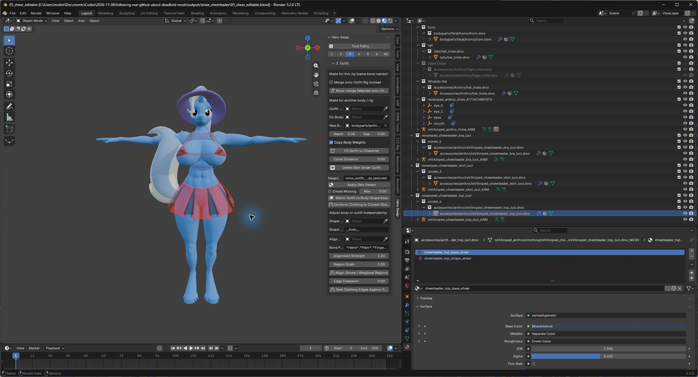
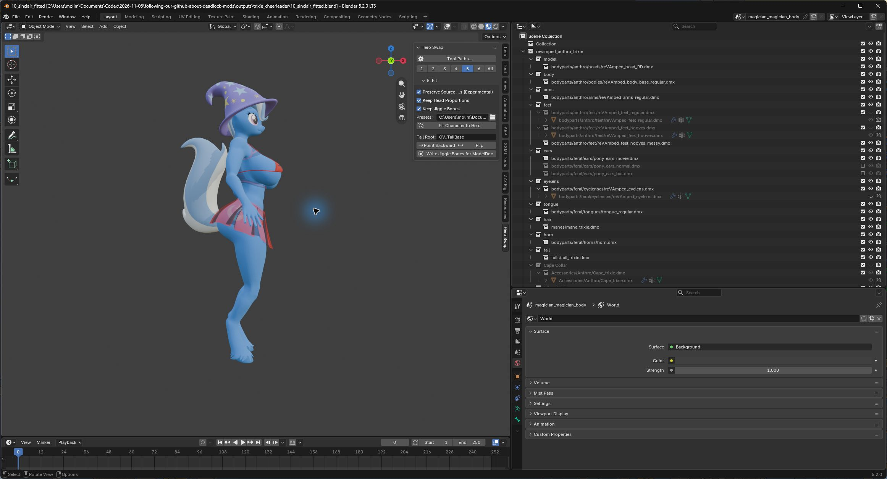
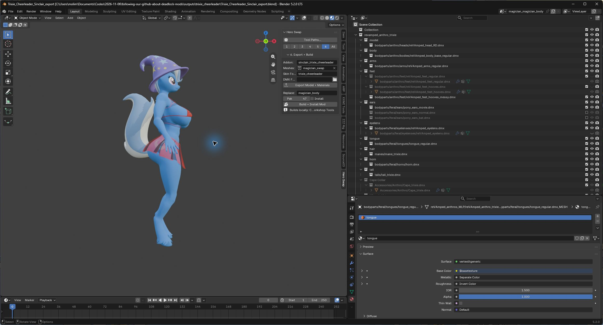
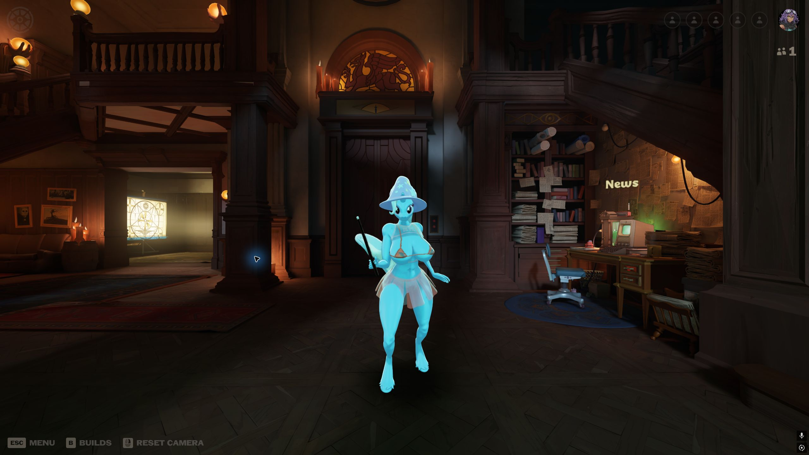
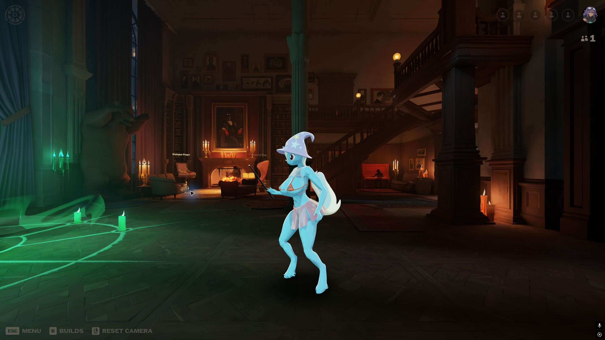

# Fit a ReVamped outfit, preserve jiggle bones, and test transparency

This workflow starts with a character whose body proportions are already set. It fits
an outfit to that body, merges it onto the character rig, preserves proportions during
the hero swap, and exports semi-transparent materials. The worked example uses an
imported ReVamped cheerleader bra, top and skirt on Trixie, replacing Sinclair.

Use the updated Hero Swap add-on in this branch. **Conform Clothing to Current Shape**
and export of an unlinked material **Alpha** value are additions to the earlier tool.
See [one-time setup](../README.md#0-one-time-setup) for the compilers and add-ons.
Screenshots below are captures of the actual Blender interface, including its icons
and buttons; labels are repeated in the text where the sidebar truncates them.

## 1. Preserve the imported scene and choose the body

Save a new `.blend` before fitting. Keep another editable checkpoint after fitting,
and use a separate copy for export. Do not overwrite the original models.

In the 3D Viewport, press **N**, open **Hero Swap**, then **2 / Character**. Set **Rig**
to the character's armature. In **3 / Outfit**, set **New Body** to its complete skin
mesh. These are different fields: an armature supplies bones; a mesh supplies shape
keys and the surface used for clothing clearance.

Keep the body shape values unchanged. Hide alternate feet, ears, outfits and duplicate
parts, and exclude them from rendering/export too. The example keeps the imported
messy hoof variant and hat. Source eye-lens meshes are excluded; select the head and
use **Convert Source Eyes to Textures** before exporting SourceIO eyes.

## 2. Match shape keys and merge the outfit

For an outfit authored for the same ReVamped skeleton:

1. Select only the outfit meshes. Leave the body unselected.
2. In **3 / Outfit**, click **Match Outfit to Body Shape Keys** (shape-key icon).
   Leave **Create Missing** off initially when the outfit already supplies matching
   controls. Existing matching names are linked to the body's values.
3. Click **Bone-merge Selected onto Character** (armature icon). Leave **Merge onto
   Outfit Rig instead** off. Each garment now follows the character's armature;
   separate garment objects and materials remain editable.
4. Check front, side and top views. Matching names alone does not guarantee a fit:
   outfits can have different topology or slightly different original proportions.
5. Set **Reach** and **Gap**, then click **Conform Clothing to Current Shape**. This
   checks the currently evaluated body and clothing shapes, moves intersecting cloth
   outward, and applies the same correction to its shape keys. It does not reshape
   the body. Run it in the rest pose with topology-changing modifiers applied first.

The example linked 41 existing keys across three garments. Its initial source-space
clearance was `0.003` with reach `0.08`. These numbers are in Blender scene units;
choose values relative to your character's size. **Gap** can display as `0.00` in a
narrow panel despite holding a nonzero value. Click the field to see its precision.

The clearance operation pushes intersections outward; it does not pull every loose
skirt panel onto the skin or recreate a missing garment panel. Inspect open edges and
layer-to-layer intersections separately. Changing shape sliders afterward requires
another fit check. Save this editable result before baking shapes.

For an outfit made for a different rig, use the separate **Outfit Rig / Its Body /
New Body** and **Fit Outfit to Character** workflow described in the
[main guide](../README.md#step-3-outfit-optional). Do not treat bone-name matching as
proof that two different skeletons have compatible rest positions.

## 3. Make selected layers semi-transparent

1. Select the outer garment, then open **Material Properties** using the material
   sphere icon on the Properties editor's vertical strip.
2. Select a material slot. If an opaque underlayer uses that same material, make a
   separate material copy first. Changing a shared material changes every user of it.
3. Under **Surface**, use a Principled BSDF material and set **Alpha** to `0.45` for
   this test. An unlinked Alpha slider is the supported constant-opacity path.
   `1.0` is opaque; `0.0` is invisible.
4. Under material **Settings / Surface**, set **Render Method** to **Blended** in
   Blender 5.2. Use **Material Preview** or Rendered view to inspect the result.
5. Repeat for the outer garment's other material slots. The example makes the top
   and skirt translucent while keeping their separate bra underlayer opaque.

Keep the skin beneath translucent cloth. **Delete Skin Under Outfit** is inappropriate
for areas that must remain visible through it. Also inspect layered transparent
surfaces from several angles: their apparent opacity and sorting can differ from a
single flat sheet, and Blender's preview is not the final game shader.

The exporter writes `F_TRANSLUCENT` and a separate `TextureTranslucency1` opacity
texture for Deadlock's `pbr.vfx`. In this constant-alpha workflow that texture contains
the slider value. An RGBA color texture alone does not supply this shader input.
Arbitrary procedural Alpha node networks are not baked by this workflow.

## 4. Fit to the hero and correct the tail

1. Choose your hero in **1 / Hero**, then **Import Hero Skeleton**. The example uses
   **Sinclair (magician)**. In **4 / Bone Map**, auto-detect, inspect the mapping and save it.
2. In **5 / Fit**, enable **Preserve Source Proportions (Experimental)** and **Keep
   Jiggle Bones**. Use a clean hero skeleton and fit only once per pre-fit checkpoint.
3. For this ReVamped example, select
   [jiggle_revamped_single_springs.json](../config/jiggle_revamped_single_springs.json)
   in **Presets**. It chooses one breast and buttock spring per side plus hair and
   tail chains. The other deformation bones remain in the rig. Review names for a
   different model; this preset is not universal.
4. Click **Fit Character to Hero**. The added `CV_` deformation bones preserve source
   lengths while following hero rotations. See the
   [proportion guide](miruko-abrams-proportions.md) for constraints and limitations.
5. Set **Tail Root** to the entire tail chain's root, `CV_TailBase` in this example,
   then click **Point Backward** (arrow icon). Check from the side and rear. Use
   **Flip** only when the tail's curl really is upside down.
6. Check clothing again in the hero's rest pose. Arm and leg rotations can introduce
   intersections even after a good source-space fit. Select the garments and repeat
   **Conform Clothing to Current Shape**, scaling Reach and Gap to the new scene size.

The example's post-fit check initially found 30 top and 60 skirt vertices more than
0.1 mm inside the body, measured back in source scale. A second clearance pass fixed
those measured intersections. This checks vertices against the body surface; it does
not prove every triangle or every animated frame is free from clipping.

The example retains 15 jiggle bones: two breast, two buttock, four hair and seven tail.
The tail root itself is a stable attachment rather than an extra physics spring.
**Write Jiggle Bones for ModelDoc** displays the settings; the export step also writes
them automatically. Do not stack independent springs through every breast tip and
expect tight cloth to stay aligned without testing.

## 5. Export and build

Save the editable fitted file first. Make a separate export copy and bake the current
shape mix there if you do not need runtime flexes. Preserve the complete body for the
transparent layers. Do not join meshes just to merge their rigs: the export collection
can contain multiple clothing objects using the same skeleton.

In **6 / Export + Build**:

1. Choose a unique **Addon** and **Skin Folder**, and check the **Meshes** collection.
2. Verify **Replace** contains only the hero body meshes being replaced. Keep weapons
   and ability props. For this Sinclair build it is `magician_body`.
3. Click **Export Model + Materials** (export arrow icon).
4. Choose a build **Pak** number. Leave **Install** unchecked when Deadlock Mod Manager
   will manage installation, then click **Build + Install Mod** (package icon).
5. Import the resulting VPK into your existing mod-manager profile. Replace only an
   older conflicting package for this same hero. Keep unrelated mods enabled and
   preserve a restore copy. Restart Deadlock after changing its installed package.

The export includes `proportion_constraints.kv3`, the jiggle settings, material remaps,
textures and DMX. The builder merges the orientation drivers into the hero's existing
constraint list. A successful compile alone does not establish that animation or
transparency works in-game.

## Validation and checkpoints

This example exported 13 meshes, 20 materials and 15 jiggle bones. The saved body shape
values were unchanged. The final rest-pose vertex test found no garment vertices more
than 0.1 mm inside the body after normalizing for hero scale. The detailed measurements
are in [the validation report](cheerleader_validation.json).

The compiled package was loaded on Sinclair in Deadlock's hideout. Front and side
inspection confirmed visible transparency in the outer top/skirt, the retained opaque
bra, the wand, and the tail positioned behind the character. Idle poses changed during
inspection. Individual physics regions and full combat animations were not exhaustively
tested; this is a transparency demonstration, not an all-animation certification.

Only the existing Trixie/Sinclair package was replaced for this test. Hash comparison
confirmed every other installed VPK, including Sunset Shimmer for Celeste, was unchanged.
The model compiler reported a single-LOD warning; it completed without compile failures.

Local deliverables are saved under `outputs/trixie_cheerleader/` in the working session:

| File | Purpose |
|---|---|
| `01_user_imported_original.blend` | Untouched imported scene |
| `08_prefit_editable.blend` | Fitted clothing, original proportions and editable shape controls |
| `10_sinclair_fitted.blend` | Editable hero fit, tail correction and jiggle setup |
| `Trixie_Cheerleader_Sinclair_export.blend` | Baked export copy |
| `Trixie_Cheerleader_Sinclair.vpk` | Compiled game package |
| `previous_Trixie_bunny_restore.vpk` | Previous installed Trixie package for rollback |

Third-party models and generated VPKs remain local. The tutorial shares the workflow,
screenshots, preset, code and measured results.
