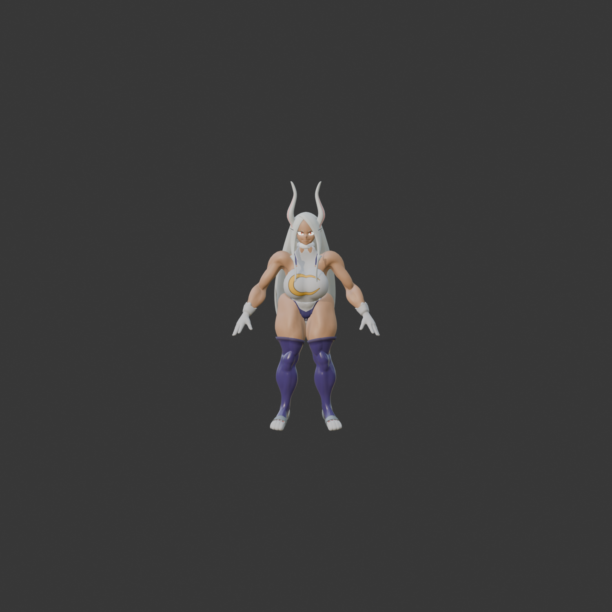
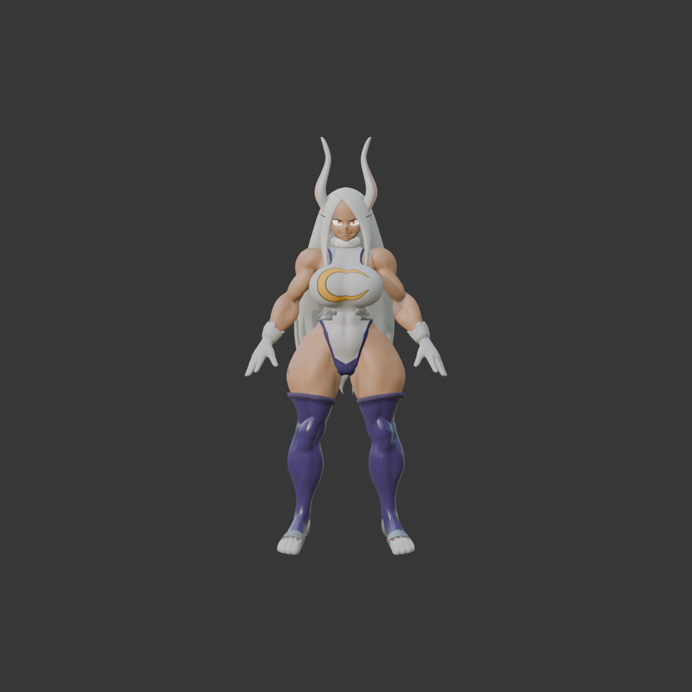
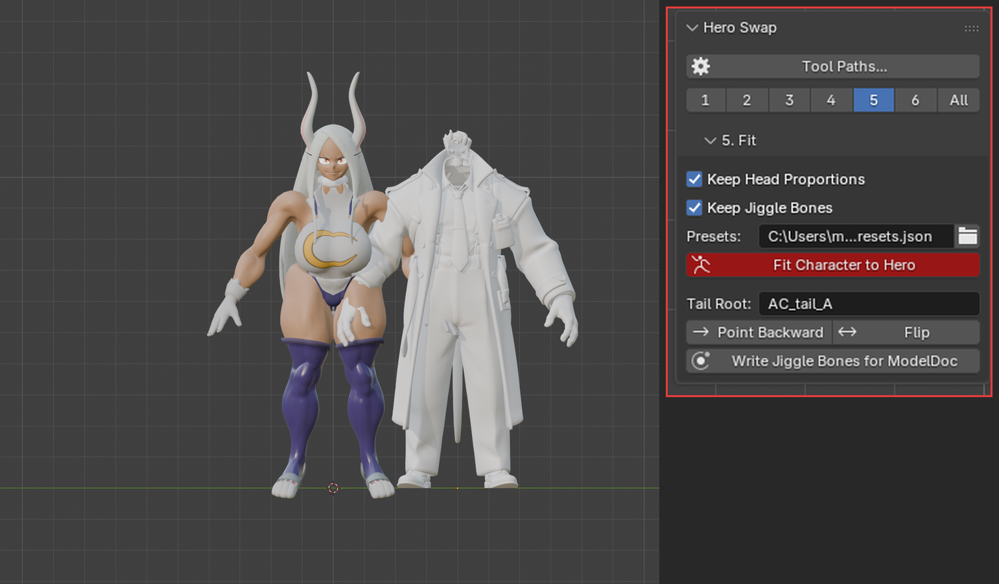
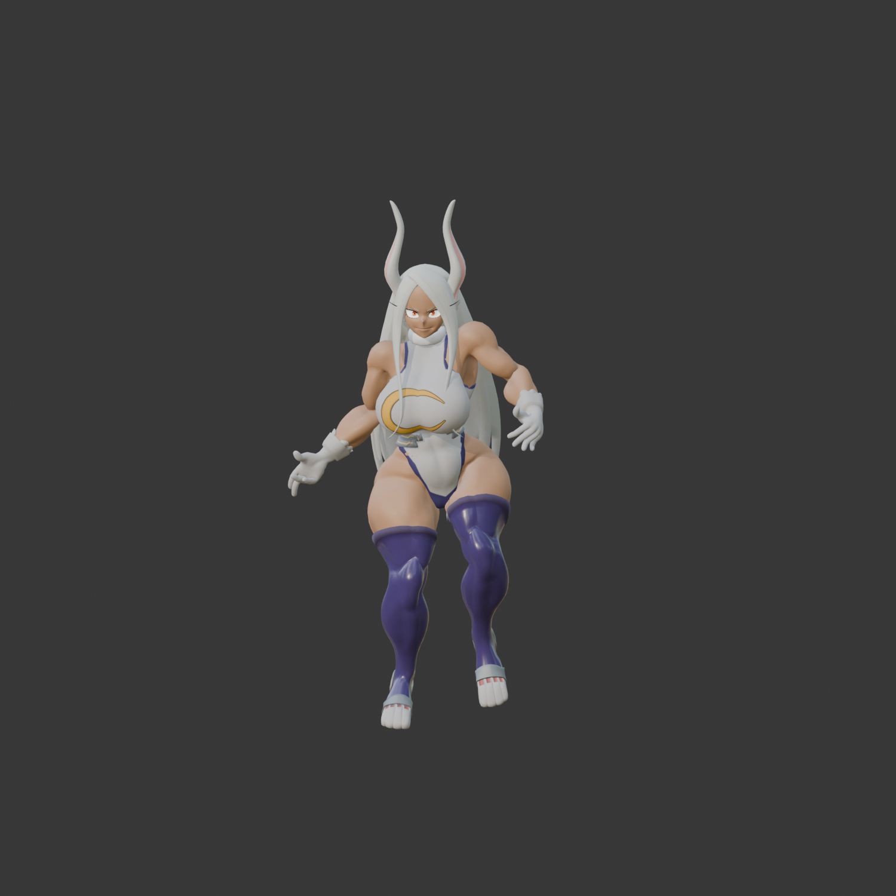
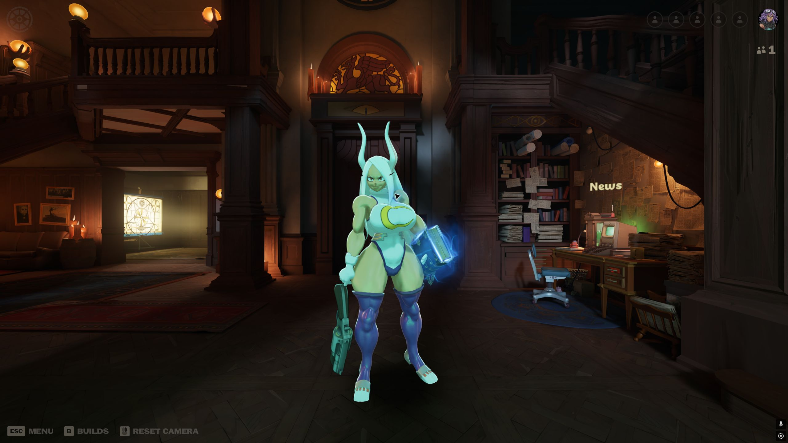
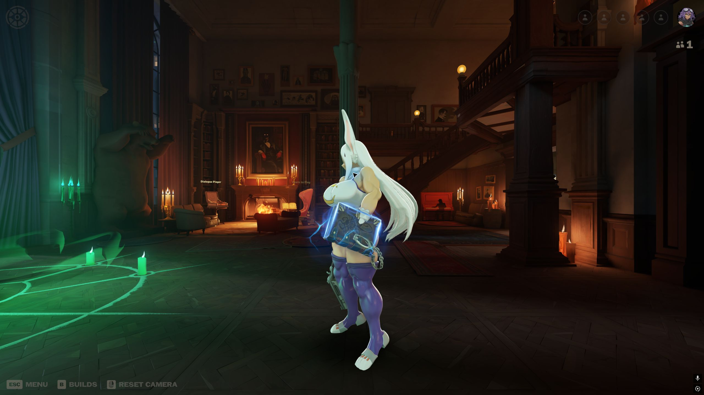
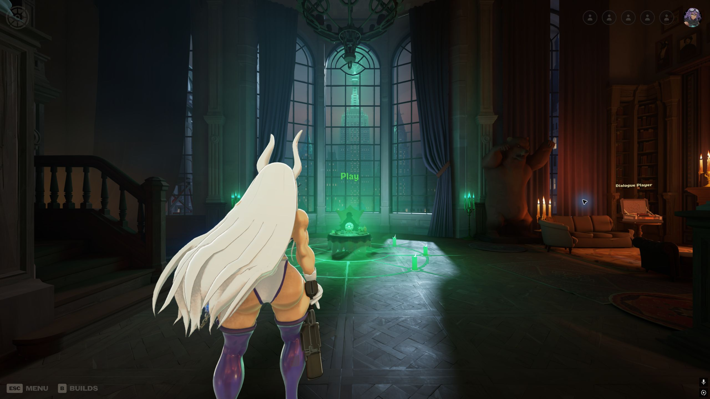

# Keeping the character's shape: torso, heel shoes, weapon grip

These three problems are the same problem wearing different hats. The moment you stop
copying the hero's skeleton lengths and start keeping the character's own, the arms and
hands end up somewhere new — so the torso stops squashing, the rigid shoes stop folding
wrong, and the gun is suddenly floating away from the hand.

Read this page when you hit any of:

- the torso came out short and crushed (**Preserve Source Proportions**)
- the heel shoes bent, melted, or float (**Preserve Heeled Shoes**)
- the character's hand no longer touches the weapon (**weapon grip fix**)

Everything here describes what was actually done to Miruko on Abrams. It's experimental,
and the "not verified yet" list at the bottom is genuinely long.

---

## Part 1 — the compressed torso

### What was going wrong

The original fit drags the character's joints onto the hero's joints. Abrams has a short,
hunched torso, so imposing his joint positions on Miruko crushes her waist. Her mesh got
the hero's spine length, and there's no undo for that once it's baked in.

### What the option does instead

**Preserve Source Proportions (Experimental)** keeps a separate `CV_` deformation
hierarchy holding the *source* segment lengths (uniformly scaled), and drives those bones
with the hero's **rotations** through ModelDoc orientation constraints. It does not copy
the shorter hero segment translations. Abrams's own skeleton and animation graph stay
where they are, and this changes nothing about the game's animation clips or gameplay
collision bounds — it is a retargeting change, nothing more.

Before:



Corrected rest pose:



### Repeat the correction

1. Install this branch's `addon/hero_swap_tools` folder and restart Blender. Tool paths and
   compilers are covered in
   [the setup section](../README.md#0-one-time-setup) — updating only the guide will not
   add the new fitting mode.
2. Open the original Miruko project or a clean pre-fit checkpoint, and **Save As a new
   working file.** Switching the option on over an already-compressed mesh cannot bring the
   original shape back.
3. Use a **fresh** Abrams skeleton. A second fit onto bones that already carry `CV_`
   deformation bones is rejected on purpose, so you don't end up with two deformation rigs.
4. Choose **Abrams** in **1. Hero** and import his skeleton. In **2. Character**, pick
   Miruko's rig, clean up the character meshes, and exclude alternate outfits and hidden
   parts from export.
5. In **4. Bone Map**, load and check the Miruko bone map: pelvis, spine, chest, neck,
   shoulders, elbows, hands, thighs, knees, feet and fingers, verified against both rigs.
   Missing torso rows are *not* a reason to squash the mesh onto Abrams's spine.
6. In **5. Fit**, enable **Preserve Source Proportions (Experimental)** and **Keep Jiggle
   Bones**, then click **Fit Character to Hero** once. Note that the older **Preserve Torso
   Proportions** option (`preserve_torso`) is a different experiment and is *not* what
   produced these results.
7. Check front and side views, then preview an Abrams animation in Blender. Look at the
   waist, shoulders, elbows and knees — and at hand/weapon and foot contact, because
   preserving lengths does not guarantee contact in every animation.
8. Save the fitted `.blend` separately from the pre-fit file, then export model and
   materials in **6. Export + Build**. The exporter writes `proportion_constraints.kv3`
   next to the model, and the builder picks it up through `build_config.json`.
9. Build the VPK. **The constraints must merge into the hero's existing single
   `AnimConstraintList`.** In our test, adding a second separate list compiled fine and
   still left the replacement frozen in its rest pose in-game. The bundled regression test
   checks that original and added constraints share one list.
10. Import the VPK with Deadlock Mod Manager's **Add Local Mod** in your existing profile.
    Replace only an older conflicting Miruko/Abrams entry, leave unrelated mods (Sunset
    Shimmer for Celeste included) enabled, restart Deadlock, and look at the character that
    actually loaded.



### What this build actually measured

- 205 deformation bones and 53 orientation drivers added. The runtime model kept the
  hero's 8 existing constraints — **61 constraints in one list.**
- All 16 measured mapped segment lengths survived uniform scaling, with a maximum relative
  error of about 0.00007%. Per-segment numbers are in
  [the Miruko measurement record](../validation/miruko_abrams_proportions.json).
- The first runtime look exposed 16 unweighted vertices (2 body, 14 tail) producing
  stretched triangles. The fitter now repairs isolated unweighted vertices from the nearest
  weighted neighbour and reports each repair; wholly unweighted parts fall back to pelvis
  attachment. Read those reports — nearest-neighbour weights are a repair, not intentional
  skinning.



*That is a Blender preview. It is not proof of gameplay locomotion.*

Corrected hideout views:




Hair motion was observed in the hideout. The legacy `hero_testing` map crashed; the current
`dl_midtown` map loaded on a local server through team selection, and testing ended before
real gameplay. A map crash does not prove the replacement model caused it.

Before calling this release-ready, walk, run, crouch, jump, melee, fire, use every Abrams
ability and every transition between them, checking feet, weapon grip, shoulder deformation
and secondary motion each time. A length measurement and a nice hideout pose cannot cover
that.

---

## Part 2 — rigid heel shoes

With **Preserve Source Proportions** enabled, **5. Fit** also exposes **Preserve Heeled
Shoes (Experimental)**. Turn it on *before* fitting rigid heels. Source foot and toe
geometry then moves as a unit during fitting and the hero ankle drives the shoe; toe and
helper bones inherit that motion instead of following separate hero toe rotations. A
reversed toe-end helper is not used to bend the shoe.

1. Save the scene, then reopen the untouched pre-fit checkpoint or reimport the original
   character. The setting cannot undo a deformation that's already baked.
2. Import a fresh hero skeleton and confirm left/right foot mappings in **4. Bone Map**.
3. Enable **Preserve Source Proportions** and **Preserve Heeled Shoes**, then click
   **Fit Character to Hero** once.
4. Inspect both soles from the side and below — heel, toe box, ankle.
5. Export, then check idle, walking, running and stairs in-game. Ground contact and leg IK
   are **not** automatically corrected just because the shoe geometry was preserved.

Leave it off for flexible shoes or bare feet that should bend at the toes — it disables
independent toe flex for the whole foot subtree. It also does not create missing geometry,
repair bad weights, or promise floor contact in every pose.

Standard `ankle_L/R` and `foot_L/R` targets are detected automatically. If your rig uses
other names, add both source foot roots to the bone-map JSON:

```json
"heel_feet": ["source_left_foot", "source_right_foot"]
```

---

## Part 3 — a weapon that follows the new hand

The proportion rig moves where the hands are, but the original gun still follows Abrams's
animation skeleton — so you get a visible gap. Keep the body geometry and weapon scale as
they are and correct the *visual* weapon instead.



*That screenshot proves the idle grip only — see "what's verified" below.*

There is still no one-click weapon-grip operator in the sidebar. This is manual DMX and
ModelDoc constraint editing, so work on a separate addon/build configuration and keep the
old VPK for rollback.

1. Extract the original hero model and weapon DMX with Source 2 Viewer. Identify the weapon
   mesh, its weighted bones, and the original hand bone; then find the matching `CV_` hand
   in the fitted rig. For this Abrams build that's `hand_R` and `CV_hand_R` — other heroes
   use other names.
2. Copy the weapon's visual bone subtree to a unique prefix such as `CVG_`, and rebind the
   gun mesh to those renamed bones. Include the animated parts (hammer, trigger, cylinder,
   hinges, safety) and the muzzle bones. Keep the original animation bones as drivers — do
   not make them depend on the new visual bones.
3. Add an **Orient** constraint for each new visual bone, driven by its original bone, and
   keep the original rotation. Then add a **Point** constraint with three bone inputs:

   | Input | Weight |
   |---|---:|
   | Original matching weapon/part bone | +1 |
   | Replacement `CV_` right hand | +1 |
   | Original right hand | −1 |

   which gives `visual_position = original_part_position + replacement_hand_position - original_hand_position`,
   with total weight 1. The whole weapon picks up the hand's changing displacement while the
   relative positions of its parts are retained. Don't swap this for a fixed rest-pose
   offset — the gap changes as the arms move.
4. Point the gun's `RenderMeshFile` reference at the corrected DMX, remap the muzzle and
   other weapon attachments onto their visual bones, and merge the constraints into the
   existing constraint list so the body drivers survive.
5. Compile, then inspect the compiled model's **DATA**: confirm every visual bone and the
   negative Point-constraint weight survived compilation. Pack at the original hero resource
   path, and keep gun scale at 1 for the first test.
6. Import the new VPK with Deadlock Mod Manager's **Add Local Mod**. Disable only the
   conflicting previous skin for that hero, keep it for rollback, and restart the game.
7. Inspect idle, aim, firing, recoil, reload, movement, melee and abilities, plus the muzzle
   effect location and both hands. A two-handed gun may also need support-hand IK or
   animation work — moving the gun cannot fix both contacts when arm lengths differ.

### What's actually verified here

The Abrams package compiled with zero failures, the compiled DATA kept the signed
constraint weights, the installed VPK hash matched the exported package, the body DMX was
reused without editing, and weapon scale stayed at 1.0. Live hideout and sandbox idle both
showed the improved right-hand contact.

**Firing, recoil and reload contact are unverified** — automated gameplay inputs didn't
register during that test. The editable Blender file from the experiment previews the
corrected rest grip; the exported ModelDoc constraints are what govern dynamic translation.

This visual fix changes neither gameplay ballistics nor collision bounds. If the grip
*rotation* or finger wrapping still looks wrong, diagnose that separately before resizing
the weapon — and please don't publish someone else's hero as "validated" just because this
Abrams package compiled.

---

## Local checkpoints from these runs

Working session files live under `outputs/miruko_abrams/` and are not committed:

| File | Purpose |
|---|---|
| `Miruko_clean_prefit.blend` | Clean source checkpoint for refitting |
| `Miruko_Abrams_driver_test.blend` | Corrected fitted/export model |
| `Miruko_Abrams_animation_preview.blend` | Saved Blender animation preview |
| `Miruko_Abrams_driver_test.vpk` | Package used for the corrected hideout inspection |
| `driver_report.json` | Bone mapping, scale, driver and weight-repair report |
| `proportion_constraints.kv3` | Runtime orientation drivers |

The guide, screenshots and code are shared on GitHub; third-party model files and generated
VPKs stay local.

Run the build regression checks from the repository root:

```powershell
python -m unittest discover -s tests -p test_modeldoc.py
```

Related: [fitting outfits and transparency](fitting-outfits-and-transparency.md) ·
[jiggle bones and presets](jiggle-bones-and-presets.md) ·
[the agent runbook](../AGENTS.md)
