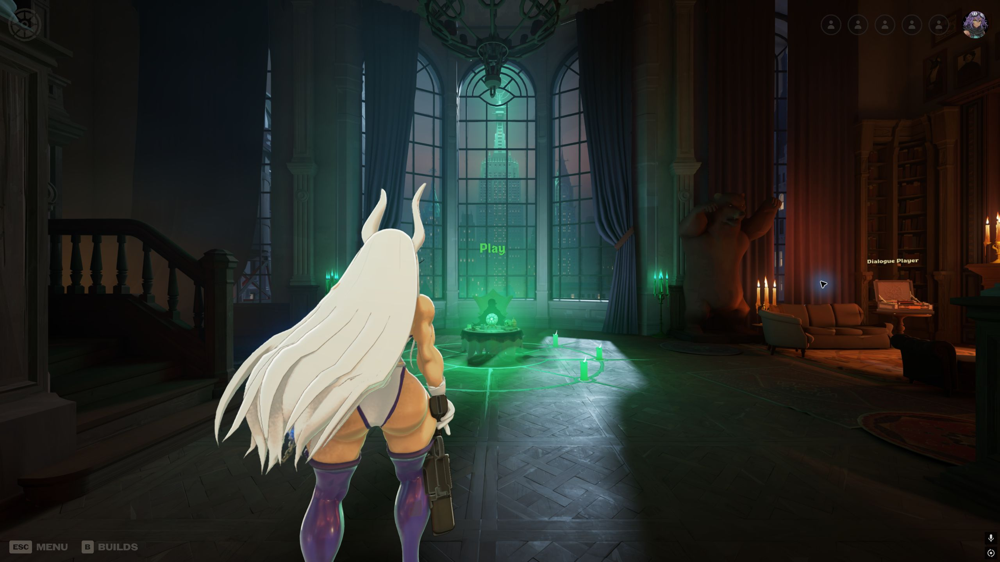

# Weapon contact while preserving character proportions

The Miruko/Abrams experiment keeps the body geometry and weapon scale unchanged.
The proportion rig changes hand positions; the original gun still follows Abrams's
animation skeleton, causing a visible gap. Correct the visual weapon separately.

## Repeating the correction

Save the working body export and preserve the old VPK in Modlock. Work on a separate
addon/build configuration. This requires editing exported DMX and ModelDoc constraint
data; there is currently no one-click weapon-grip operator in the Blender sidebar.

1. Extract the original hero model and weapon DMX with Source 2 Viewer. Identify the
   weapon mesh, its weighted bones, and the original hand bone. Inspect the fitted
   rig to find the corresponding `CV_` hand. For this Abrams build these are
   `hand_R` and `CV_hand_R`; names differ for other heroes.
2. Copy the weapon's visual bone subtree to a unique prefix, such as `CVG_`. Rebind
   the gun mesh to those renamed bones. Include animated parts (hammer, trigger,
   cylinder, hinges, safety) and muzzle bones. Preserve the original animation bones
   as drivers; do not make them depend on the new visual bones.
3. Add an Orient constraint for each new visual bone, driven by its original bone.
   Keep the original rotation. Add a Point constraint with three bone inputs:

   | Input | Weight |
   |---|---:|
   | Original matching weapon/part bone | +1 |
   | Replacement `CV_` right hand | +1 |
   | Original right hand | -1 |

   Thus `visual_position = original_part_position + replacement_hand_position - original_hand_position`.
   The total weight is 1. This applies the changing hand displacement to the whole
   weapon while retaining the original relative part positions. Do not substitute
   a fixed rest-pose offset: the gap can change as the arms move.
4. Replace the gun RenderMeshFile reference with the corrected DMX. Remap muzzle
   and other weapon attachments to their corresponding visual bones. Merge the
   constraints into the existing constraint list, retaining the body drivers.
5. Compile and inspect the compiled model DATA. Confirm all visual bones and the
   negative point-constraint weight survived compilation. Pack the corrected model
   at the original hero resource path. Keep gun scale at 1 for the first test.
6. Import the new VPK with Modlock's **Add Local Mod**. Disable only the conflicting
   previous skin for that hero; preserve it for rollback. Restart the game.
7. Inspect idle, aim, firing, recoil, reload, movement, melee and abilities. Check
   the muzzle effect location and both hands. A two-handed gun may additionally
   need support-hand IK/animation work; translating the gun cannot solve both
   contacts when the character's arm lengths differ.

## What has actually been checked

The Abrams package compiled with zero failures. Compiled DATA retained the signed
constraint weights, and the installed VPK hash matched the exported package. The
body DMX was reused without editing and weapon scale remained 1.0. Live hideout
and sandbox idle showed the improved right-hand contact.

**Firing, recoil and reload contact remain unverified.** Automated gameplay inputs
did not register during that test. The screenshot above proves only the idle result.
The editable Blender file from that experiment previews the corrected rest grip;
the exported ModelDoc constraints are authoritative for dynamic translation.

This visual correction does not change gameplay ballistics or collision bounds.
If the grip rotation or finger wrapping is still wrong, diagnose that separately
before changing weapon size. Do not publish another hero's result as validated
solely because this Abrams package compiled.
